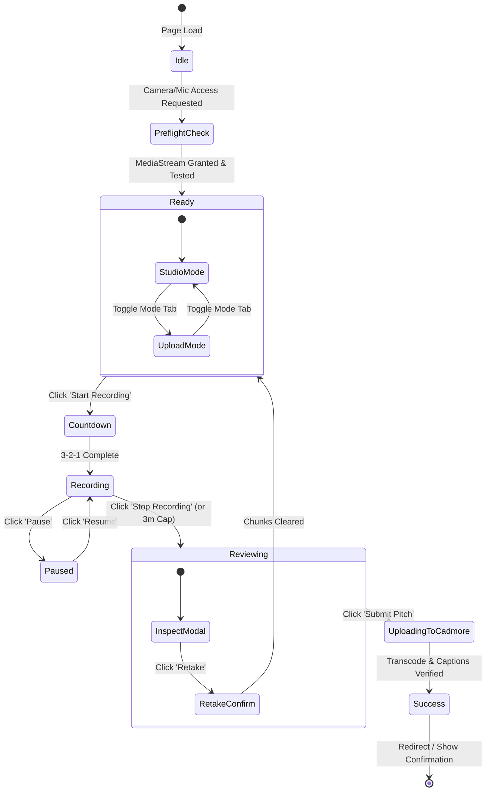

# Author Studio Specification & Architectural Blueprint
## Pitch It — Video-First Scholarly Submission & Author KYC

> **Document Version**: 2.0 (UI & Functional Blueprint)  
> **Target Path**: `pitch-it/docs/02.author_studio.md`  
> **Route**: `/` or `/author-studio`  
> **Integrated Systems**: **Kriyadocs 2.0** (`kriya2.0`, `kriya2.0_view`, `k-simplexmldb`, `elasticnodeproxy`) & **Cadmore Media Video Cloud**

---

## 1. Executive Overview & Purpose

The **Author Studio** (`/author-studio` or `/`) is the frontline entry point of the **Pitch It** platform. It replaces the traditional, dry, text-only manuscript upload step with a guided, high-impact **multimedia presentation studio**.

### Core Mission:
1. **Scientific KYC (Know Your Customer)**: Establishes authentic author identity on camera, deterring automated AI spam and predatory paper mill submissions.
2. **2-to-3 Minute Executive Pitch**: Empowers the author to articulate their clinical/scientific hypothesis, methodology novelty, primary findings, and real-world significance in their own voice.
3. **Dual Submission Flexibility**:
   - **Mode A: Live Camera Studio**: Browser-based WebRTC recording with synchronized slide deck, teleprompter, and live audio-visual anonymization.
   - **Mode B: Upload Pre-Rendered / AI Video**: Directly upload an MP4 created via external tools (such as **Google Vids**, PowerPoint Video, or Canva) with slide sync.
4. **Double-Blind Integrity**: Provides real-time AI audio-visual anonymization (face silhouette/blur and pitch-shifted voice modulation) for double-blind journals without compromising the author's argument.
5. **Seamless Cloud Ingestion**: Automatically syndicates media to **Cadmore Media** for adaptive streaming, automatic closed-captioning (VTT), and Crossref video DOI registration.

---

## 2. Comprehensive UI Layout & Wireframe Blueprint

The page is designed with a **2-Column Responsive Workspace** with a dark, professional editorial theme (`bg-slate-950`).

```
+---------------------------------------------------------------------------------------------------------+
| [BMJ Open Logo]  BMJ-2026-08912: Adaptive Immunotherapy in Pancreatic Cancer    [🛡️ Double-Blind Active] |
+---------------------------------------------------------------------------------------------------------+
|  LEFT PANEL (55% Width): SLIDE DECK PRESENTER         | RIGHT PANEL (45% Width): STUDIO & CAMERA RECORDER|
|                                                       |                                                 |
|  [ Template: Clinical Trial ▼ ] [ AI Script Assist ✨] |  [ (●) Live Camera Studio ]  [ (↑) Upload Video ]|
|  +-------------------------------------------------+  |  +-------------------------------------------+  |
|  |                                                 |  |  | [Webcam Viewfinder / Canvas Filter]       |  |
|  |                CURRENT SLIDE                    |  |  |                                           |  |
|  |           (High-Res Slide / Card)               |  |  |  [🛡️ Face Silhouette Masked]              |  |
|  |                                                 |  |  +-------------------------------------------+  |
|  |                                                 |  |  | 📜 TELEPROMPTER OVERLAY                    |  |
|  +-------------------------------------------------+  |  | "We evaluated 142 refractory patients..."  |  |
|  | [◀ Prev Slide]      Slide 2 of 4     [Next Slide ▶]|  | Speed: [====●====] 135 WPM (🟢 Ideal Pace) |  |
|  +-------------------------------------------------+  |  +-------------------------------------------+  |
|  | 💡 PRESENTER CUE NOTES:                          |  |  | 🔴 [Start Recording]   [⏸ Pause] [↺ Retake]|  |
|  | - Highlight why traditional chemo failed cohort  |  |  | Timer: [ 01:24 / 03:00 ]   Mic: [||||||||  ] |  |
|  | - Emphasize Phase II p-value (p < 0.001)        |  |  +-------------------------------------------+  |
|  +-------------------------------------------------+  |  | ANONYMIZATION CONTROLS:                   |  |
|                                                       |  | [x] Visual Face Silhouette  [x] Pitch Voice|  |
+---------------------------------------------------------------------------------------------------------+
|  FOOTER ACTIONS: [ ↺ Reset All ]              [ 👁️ Preview Both Versions ]    [ 🚀 Submit to Cadmore ▶ ] |
+---------------------------------------------------------------------------------------------------------+
```

---

## 3. Detailed Functional Modules & Component Breakdown

### Module 1: Global Header & Context Bar
* **Manuscript Breadcrumb**: Customer Logo (BMJ Open / Frontiers / eLife) + Manuscript ID (`BMJ-2026-08912`) + Short Title.
* **Blinded Mode Status Pill**:
  - If **Double-Blind**: `bg-indigo-500/10 border-indigo-500/30 text-indigo-400` with Shield Icon: *"Double-Blind Peer Review Active: Face & voice will be shielded for reviewers."*
  - If **Single-Blind / Open**: `bg-emerald-500/10 text-emerald-400`: *"Open / Single-Blind Submission: Video will display author credentials."*
* **Target Duration Badge**: `⏱️ Target: 2m 00s (Max: 3m 00s)`.

---

### Module 2: Left Panel — Slide Deck Presenter
1. **Template Archetype Selector (Dropdown)**:
   - `Clinical Trial Protocol & Findings` (Default).
   - `Basic Science / Lab Bench Discovery`.
   - `Systematic Review & Meta-Analysis`.
   - `Case Study & Surgical Protocol`.
2. **AI Pitch Script Generator Button (`✨ Generate Pitch Script with AI`)**:
   - When clicked, queries backend LLM using the manuscript's abstract.
   - In 2 seconds, populates all 4 slides with bulleted talking points and loads the teleprompter.
3. **Slide Canvas Viewport**:
   - Renders the current slide in high-resolution 16:9 aspect ratio.
   - Supports 4 default structured slide archetypes:
     - **Slide 1**: *The Clinical Gap & Unmet Need*
     - **Slide 2**: *Novel Methodology & Lab Regimen*
     - **Slide 3**: *Primary Findings & Statistical Proof*
     - **Slide 4**: *Real-World Significance & Triage Pitch*
4. **Slide Navigation Toolbar**:
   - `[◀ Previous Slide]` button.
   - Slide Pagination Pill: `Slide X of 4`.
   - `[Next Slide ▶]` button.
   - *(Keyboard Shortcut: Left / Right arrow keys advance slides during live recording).*
5. **Presenter Cue Cards**:
   - Displays concise reminder notes tailored specifically to the active slide to guide the author without reading verbatim.

---

### Module 3: Right Panel — Studio & Recording Engine

Authors can toggle between two primary creation modes:

#### Mode A: Live Camera Studio (Default)
1. **Webcam Viewfinder**:
   - Live 720p/1080p WebRTC camera feed.
   - **Hardware Diagnostics**: Select camera device, select microphone device, live VU audio meter.
2. **Live Anonymization Canvas**:
   - **Visual Face Mask**: Real-time canvas filter applying a facial silhouette mask or soft blur.
   - **Voice Modulator**: Web Audio API low-shelf filter shifting pitch down by 4 semitones to disguise identity.
3. **In-Camera Teleprompter**:
   - Transparent overlay positioned directly below the webcam viewfinder to ensure natural eye contact.
   - Controls: Auto-scroll toggle, Speed slider (100–180 WPM), Text font size (`A- / A+`).
   - **Pacing Coach**: Real-time feedback badge:
     - 🟢 *Ideal Pace (130–150 WPM)*
     - 🟡 *Pacing Fast (>175 WPM)*
     - 🟠 *Pacing Slow (<100 WPM)*
4. **Recording Controller Bar**:
   - **Countdown Overlay**: 3-2-1 visual countdown before recording activates.
   - **Big Red Action Button**: `[ ● Start Recording ]` $\rightarrow$ transitions to `[ ⏹ Stop Recording ]`.
   - **Pause / Resume**: `[ ⏸ Pause ]` for coughing or pausing.
   - **Retake / Re-record**: `[ ↺ Retake ]` with safety confirmation dialog.
   - **Live Timer**: Shows elapsed time (`01:42 / 03:00`). If exceeding 02:45, timer pulses yellow; at 03:00, recording auto-stops gracefully.

#### Mode B: Upload Pre-Rendered / AI Video (e.g., Google Vids / MP4)
* For authors who prepared an AI presentation via **Google Vids**, Canva, or PowerPoint:
  1. **Drag-and-Drop Dropzone**: Supports `.mp4`, `.webm`, `.mov` (up to 200 MB).
  2. **File Validation**: Auto-checks duration (warns if > 4 minutes) and resolution.
  3. **Immediate Preview Player**: Allows author to play and confirm synchronization with uploaded slide deck.

---

### Module 4: Bottom Bar & Dual-Stream Preview Modal

1. **Footer Action Bar**:
   - `[ ↺ Reset All ]`: Clears recorded chunks and resets to initial state.
   - `[ 👁️ Preview Dual Streams ]`: Opens the side-by-side inspection modal.
   - `[ 🚀 Submit to Cadmore ▶ ]`: Initiates multipart upload, captioning, and submission.

2. **Dual-Stream Inspection Modal**:
   - **Tab 1: Author View (Raw)**: Displays the unedited camera feed and natural voice (verifies clarity).
   - **Tab 2: Blinded Reviewer View (Anonymized)**: Displays the video exactly as the double-blind editor/reviewer will see it (masked face + modulated voice).
   - Confirms that no personal, gender, racial, or institutional identifiers leak through.

---

## 4. Frontend State Machine (React & Zustand)

The Author Studio UI operates on a robust finite state machine to prevent race conditions:



### Component State Types (`client/src/types/authorStudio.ts`):
```typescript
export type StudioMode = "live_record" | "upload_video";

export type RecordingState = 
  | "idle" 
  | "preflight" 
  | "countdown" 
  | "recording" 
  | "paused" 
  | "reviewing" 
  | "uploading" 
  | "success";

export interface SlideItem {
  pageNumber: number;
  title: string;
  notes: string;
  thumbnailUrl?: string;
}

export interface AnonymizationConfig {
  visualMaskEnabled: boolean;
  voiceModulationEnabled: boolean;
  journalPolicyEnforced: boolean; // True if double-blind workflow
}
```

---

## 5. Client Component File Structure

```
client/src/
├── pages/
│   └── AuthorStudioPage.tsx             # Master grid layout orchestrator
├── components/author-studio/
│   ├── HeaderContextBar.tsx             # Journal title, manuscript ID, Blinded shield
│   ├── SlideDeckPresenter.tsx           # 16:9 Slide canvas, Prev/Next buttons, cue notes
│   ├── TemplateSelector.tsx             # Clinical / Basic Science archetype selector
│   ├── VideoStudioRecorder.tsx          # WebRTC camera feed, countdown, timer, VU meter
│   ├── VideoUploadDropzone.tsx          # Google Vids / MP4 drag-and-drop uploader
│   ├── TeleprompterOverlay.tsx          # Auto-scroll text, speed slider, WPM coach
│   ├── AnonymizationToggleCard.tsx      # Face silhouette & Voice pitch toggles
│   ├── DualPreviewModal.tsx             # Side-by-side Raw vs Blinded preview player
│   └── CadmoreUploadProgress.tsx        # S3 upload bar, transcoding & caption loader
├── hooks/
│   ├── useMediaRecorder.ts              # WebRTC MediaRecorder lifecycle with IndexedDB buffer
│   ├── useVoiceModulation.ts            # Web Audio API real-time pitch-shifting
│   ├── useCanvasMasking.ts              # Real-time face silhouette drawing on canvas
│   └── useCadmoreDirectUpload.ts        # Multipart upload with progress callback
└── lib/
    ├── api.ts                           # Pitch It REST client
    └── storage.ts                       # IndexedDB local cache for crash recovery
```

---

## 6. Server-Side Integration (Kriyadocs 2.0 & Cadmore)

### REST API Endpoints:

| Endpoint | Method | Role | Description |
|---|---|---|---|
| `/api/v1/pitch/session/:manuscriptId` | `GET` | Author | Fetches manuscript title, abstract, and loads blinded policy from `kriya2.0_view/workflowTemplate.xml`. |
| `/api/v1/pitch/script-assist` | `POST` | Author | Calls Kriyadocs LLM to transform abstract into 4 structured slide cue notes & teleprompter script. |
| `/api/v1/pitch/presign-upload` | `POST` | Author | Generates AWS S3 / Cadmore presigned multipart URLs for direct browser-to-cloud upload. |
| `/api/v1/pitch/complete` | `POST` | Author | Locks author submission, registers video metadata in `elasticnodeproxy`, and triggers Cadmore transcoding. |
| `/api/v1/webhooks/cadmore` | `POST` | Cadmore | Webhook returning HLS master playlist URL, VTT captions file, and Crossref video DOIs. |

---

## 7. Developer UI Implementation Checklist

- [ ] **Header**: Display manuscript breadcrumb, DOI preview, and dynamic Double-Blind shield badge.
- [ ] **Left Panel**: Build 16:9 Slide Presenter with keyboard arrow navigation (`◀`, `▶`).
- [ ] **Left Panel**: Add Template dropdown & `✨ Generate Pitch Script with AI` button.
- [ ] **Right Panel**: Implement Mode Switcher tabs: `(●) Live Camera Studio` vs `(↑) Upload Video`.
- [ ] **Live Studio**: Connect WebRTC `getUserMedia` with live VU audio level bar.
- [ ] **Live Studio**: Build countdown (3-2-1), live recording timer with 3-minute hard ceiling, and retake alert.
- [ ] **Live Studio**: Add transparent teleprompter overlay with WPM cadence indicator.
- [ ] **Anonymization**: Implement Web Audio pitch modulator and canvas face silhouette mask.
- [ ] **Upload Mode**: Build drag-and-drop dropzone for Google Vids / MP4 files with instant preview.
- [ ] **Preview Modal**: Build side-by-side dual player (`Author View` vs `Reviewer Blinded View`).
- [ ] **Upload Flow**: Implement direct Cadmore S3 upload with percentage progress bar.
- [ ] **Safety**: Store recorded blobs concurrently in `IndexedDB` to guarantee zero data loss on browser crash.
