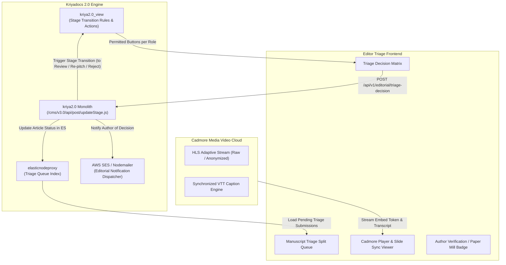
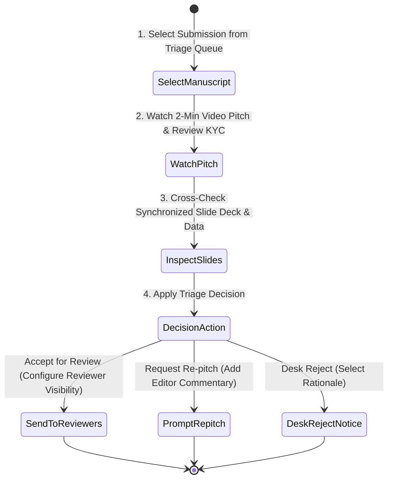

# Editor Triage Dashboard Specification & Architectural Blueprint
## Pitch It — Video-Assisted Rapid Screening & Author Identity Verification

> **Document Version**: 1.0  
> **Target Path**: `pitch-it/documents/03.editor_triage.md`  
> **Integrated Systems**: **Kriyadocs 2.0** (`kriya2.0`, `kriya2.0_view`, `elasticnodeproxy`) & **Cadmore Media Video Cloud**

---

## 1. Executive Overview & Purpose

The **Editor Triage Dashboard** (`/editor-triage`) is the primary mission-control interface for journal Editors-in-Chief, Section Editors, and Associate Editors.

### Core Mission:
1. **Compress Triage Time (Hours to Minutes)**: Editors no longer need to read an entire 40-page PDF manuscript just to determine if it fits journal scope. A high-impact 2-minute video pitch provides instant comprehension of research novelty and methodology.
2. **Scientific KYC & Anti-Paper-Mill Verification**: Authenticates the author's identity and deep subject-matter mastery on camera, filtering out AI-hallucinated and paper-mill ghostwritten submissions.
3. **Desk Decisions with 1-Click Actionability**:
   - `Accept for Peer Review`: Progresses manuscript to reviewer assignment.
   - `Request Re-pitch`: Asks author to re-record or address a specific scientific query before full peer review.
   - `Desk Reject`: Fast, courteous rejection with structured rationale.
4. **Blinded Workflow Enforcement**: Controls whether peer reviewers receive the raw video or the AI-anonymized stream based on publisher policy.

---

## 2. Alignment with Kriyadocs 2.0 Architecture



1. **Role-Based Toolbar Controls (`kriya2.0_view`)**:
   - Reads `_config_review_content.xml` for Editor roles (`editor_in_chief`, `managing_editor`, `section_editor`).
   - Dynamically enables or hides decision buttons and blind-mode toggles based on publisher configuration.
2. **Elasticsearch Triage Indexing (`elasticnodeproxy`)**:
   - Queries `kriya2.0`'s Elasticsearch cluster to fetch submissions marked `status: pending_triage`, enriched with Cadmore video IDs and pitch metadata.
3. **Kriyadocs Stage State Machine**:
   - A decision triggers `updateStage.js`, transitioning the paper from `STAGE_SUBMISSION` to `STAGE_PEER_REVIEW`, `STAGE_RE_PITCH`, or `STAGE_REJECTED`.

---

## 3. What Needs to be Done: Step-by-Step User Journey



### Step 1: Split-Screen Triage Queue
- Left Panel: List of pending submissions displaying:
  - Manuscript ID, Journal Title, Submission Date.
  - Video Pitch status indicator (`Ready 2m 14s`, `Processing`, `No Pitch`).
  - **KYC Verification Badge** (`Author Verified via Video`, `Single-Author Warning`, `Paper Mill Risk: Low`).
  - Novelty & Clinical Scope tags.

### Step 2: Synchronized Video & Slide Presentation
- Center/Right Panel:
  - **Cadmore HD Video Player** with synchronized presenter slides.
  - As the author speaks, the slides advance in real-time, or the editor can click any slide thumbnail to jump the video to that exact chapter.
  - Interactive transcript panel with live keyword search.

### Step 3: Author Scientific Identity Check
- Displays author ORCID profile, previous publication track record, and verified institutional affiliation.
- Editor confirms that the presenter on camera matches the corresponding author credentials.

### Step 4: Decision Execution & Reviewer Permissions
- Editor selects one of three primary triage paths:
  1. **Accept for Review**: Prompts reviewer visibility settings:
     - `Show Anonymized Video Only` (Strict double-blind).
     - `Show Full Video + Slides` (Single-blind / Open).
     - `Do Not Share Video with Reviewers` (Editor-only triage).
  2. **Request Re-pitch**: Opens video/text prompt modal requesting author to clarify specific clinical data or statistical methods.
  3. **Desk Reject**: Selects predefined journal scope reasons and automatically dispatches courteous notification.

---

## 4. Innovative "Delight" Features (Ultra User-Friendly)

### 1. "AI 30-Second Executive Summary & Jump Markers"
* **The Problem**: Editors have back-to-back surgeries, clinic hours, or teaching duties.
* **Solution**: AI analyzes the author's speech transcript and generates a **30-second bullet summary** with clickable timestamp links:
  - *"Clinical Hypothesis [0:12]"*
  - *"Cohort Size & Methodology [0:48]"*
  - *"Primary Endpoint p-value [1:15]"*
  - *"Limitations acknowledged [1:50]"*

### 2. "Paper Mill Integrity Risk Score"
* **Solution**: Pitch It cross-analyzes:
  - Video facial landmark naturalness (detecting deepfake/avatar anomalies).
  - Speech consistency with the uploaded manuscript vocabulary.
  - Author ORCID publication history.
* Gives the editor a confidence rating: 🟢 *Authentic Researcher Verified* | 🔴 *Anomaly Detected: Further KYC Required*.

### 3. "1-Click Reviewer Matcher based on Pitch Topics"
* System extracts key concepts spoken in the video pitch and queries Kriyadocs’ reviewer database.
* Suggests top 3 available peer reviewers who have published in the exact sub-domain, with 1-click invite dispatch.

### 4. Picture-in-Picture (PiP) Floating Pitch Player
* Editor can pop the video pitch out into a floating PiP window and browse the full manuscript text or figures simultaneously without interrupting playback.

---

## 5. Client-Side (Frontend) Technical Specifications

### Architecture & Tech Stack:
- **Framework**: React 19 + TypeScript
- **Styling**: Tailwind CSS (Optimized dark-mode triage view)
- **Icons**: Lucide React
- **Player**: Cadmore Universal Media Player React SDK

### Key Client Modules:
```
client/src/
├── pages/
│   └── EditorTriagePage.tsx              # Main triage layout orchestrator
├── components/triage/
│   ├── TriageQueueSidebar.tsx            # Left list with search, filter, and KYC badges
│   ├── SynchronizedPlayer.tsx            # Cadmore video + Slide Deck synchronizer
│   ├── TranscriptSearchPanel.tsx         # Searchable interactive speech transcript
│   ├── AuthorKycCard.tsx                 # ORCID history, identity checklist
│   ├── DecisionModal.tsx                 # Decision execution dialog
│   └── ReviewerVisibilityPicker.tsx      # Blinded mode video distribution controls
└── hooks/
    ├── useTriageQueue.ts                 # Fetch & cache pending submissions
    └── useSynchronizedSlides.ts          # Keep video timestamp and slide index in sync
```

---

## 6. Server-Side (Backend) Technical Specifications

### REST API Endpoints:

| Endpoint | Method | Role | Description |
|---|---|---|---|
| `/api/v1/editorial/triage-queue` | `GET` | Editor | Returns all submissions waiting in `STAGE_SUBMISSION` with pitch metadata and KYC status. |
| `/api/v1/editorial/pitch/:pitchId` | `GET` | Editor | Returns Cadmore streaming token, synchronized slide deck, chapters, and VTT transcript. |
| `/api/v1/editorial/triage-decision` | `POST` | Editor | Applies decision (`accept_for_review`, `request_repitch`, `desk_reject`) and invokes `kriya2.0` stage transition. |
| `/api/v1/editorial/suggest-reviewers` | `POST` | Editor | Uses pitch keywords to query suitable reviewers from Kriyadocs reviewer database. |

### Decision Payload Schema (`POST /api/v1/editorial/triage-decision`):
```json
{
  "manuscriptId": "BMJ-2026-08912",
  "pitchId": "PITCH-2026-0941",
  "decision": "accept_for_review",
  "notes": "Novel methodology in Phase II cohort. Suitable for expert oncology review.",
  "reviewerVideoAccess": "anonymized_stream_only",
  "allocatedSectionEditorId": "ed_5810",
  "timestamp": "2026-11-09T21:40:00Z"
}
```

---

## 7. Implementation Checklist for Developers

- [ ] **Frontend**: Build split-screen responsive triage layout with collapsible queue.
- [ ] **Frontend**: Implement synchronized slide-to-video playback using Cadmore SDK timeupdate events.
- [ ] **Frontend**: Create KYC Author Verification card with paper-mill risk indicators.
- [ ] **Frontend**: Build Decision modal with blind-mode reviewer visibility toggles.
- [ ] **Backend**: Connect queue endpoint to `elasticnodeproxy` query template.
- [ ] **Backend**: Integrate with `kriya2.0/cms/v3.0/api/post/updateStage.js` for stage state transitions.
- [ ] **Backend**: Implement email notification templates in `kriya2.0_view` for Re-pitch requests.

