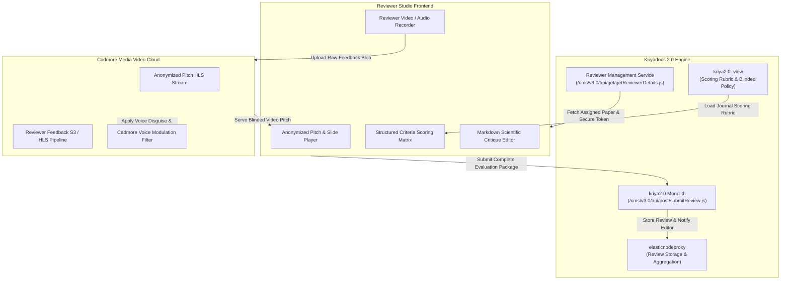
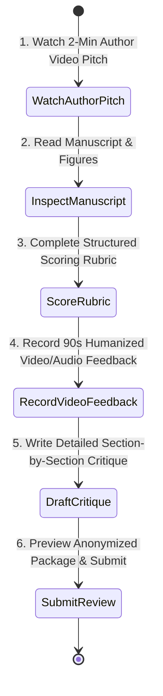

# Reviewer Evaluation Studio Specification & Architectural Blueprint
## Pitch It — Video-Enticed Peer Review & Humanized Feedback Studio

> **Document Version**: 1.0  
> **Target Path**: `pitch-it/documents/04.reviewer_feedback.md`  
> **Integrated Systems**: **Kriyadocs 2.0** (`kriya2.0`, `kriya2.0_view`, `elasticnodeproxy`) & **Cadmore Media Video Cloud**

---

## 1. Executive Overview & Purpose

The **Reviewer Evaluation Studio** (`/reviewer-feedback`) is the dedicated workspace for external peer reviewers (academics, clinical investigators, and biostatisticians).

### Core Mission:
1. **Solve Collapsing Reviewer Acceptance Rates**: Overburdened researchers routinely decline peer review requests when faced with a 40-page technical PDF. A 2-minute video pitch immediately shows the study's relevance, passion, and novelty, enticing busy reviewers to accept invitations.
2. **Double-Blind Impartiality**: In double-blind journals, reviewers receive the AI-anonymized video stream (voice-modulated and visual silhouette) to prevent unconscious bias.
3. **Dual Feedback Channel (Text + 90-Second Conversational Video/Audio)**:
   - Written peer reviews often come across as cold, adversarial, or ambiguous.
   - Reviewers can record a 90-second conversational video or audio note. This humanizes critique, conveys collegial warmth, and clearly explains complex experimental revisions.
4. **Anonymized Reviewer Privacy**: If the journal enforces anonymous review, the reviewer's own video feedback is processed through voice modulation, protecting their professional identity.

---

## 2. Alignment with Kriyadocs 2.0 Architecture



1. **Reviewer Assignment & Masked Identity (`kriya2.0`)**:
   - Reviews are tied to pseudonymous labels (`Reviewer 1 - Statistical Geneticist`, `Reviewer 2 - Clinical Oncologist`).
   - The system validates the reviewer's one-time invitation token generated by `kriya2.0`.
2. **Publisher Scoring Rubric (`kriya2.0_view`)**:
   - Loads criteria from `kriya2.0_view/db/kriyadocs/customers/{publisher}/config/default/_config_review_content.xml`.
   - Different journals mandate different scoring facets (e.g., Clinical Rigor vs. Theoretical Innovation).
3. **Cadmore Reviewer Voice Modulation**:
   - When a reviewer records video/audio feedback, the audio stream is pitch-shifted before the editorial office shares it with the author.

---

## 3. What Needs to be Done: Step-by-Step User Journey



### Step 1: Author Pitch Evaluation
- Reviewer launches the studio from their secure invitation email.
- Plays the 2-minute author video pitch alongside synchronized slides.
- Can speed up playback (1.25x / 1.5x) or search transcript keywords.

### Step 2: Structured Criteria Scoring Matrix
- Interactive scoring sliders (1 to 5 stars or numerical scale):
  - **Methodological Rigor & Cohort Size**
  - **Scientific Originality & Novelty**
  - **Statistical Proof & Clarity of Results**
  - **Clinical / Real-World Impact**

### Step 3: 90-Second Humanized Video/Audio Feedback Recorder
- Integrated WebRTC recorder tailored for reviewers:
  - Mode selector: `Video + Audio` or `Audio Only` (for camera-shy reviewers).
  - Teleprompter cue points: *"1. What was the strongest point? 2. What critical revision is needed? 3. Tone of recommendation."*
  - Live audio VU meter and countdown timer (maximum 90 seconds).
  - Real-time preview with voice disguise filter toggle.

### Step 4: Written Scientific Critique & Submission
- Standard markdown editor for detailed line-by-line comments (Major Revisions, Minor Revisions, Confidential Comments to the Editor).
- Recommendation decision dropdown:
  - `Accept without Revision`
  - `Minor Revision`
  - `Major Revision`
  - `Reject & Suggest Transfer`
- Reviewer confirms submission; system securely archives both text and media feedback.

---

## 4. Innovative "Delight" Features (Ultra User-Friendly)

### 1. Timestamped Video Annotations on Author Slides
* **The Problem**: Writing *"On slide 3, the graph on the bottom right has ambiguous error bars"* takes unnecessary effort.
* **Solution**: While watching the author's pitch, the reviewer can pause and click anywhere on the slide or video timeline to pin a **Timestamped Video Note** (e.g., *"@ 1:14: Please clarify whether error bars represent SEM or 95% CI"*).

### 2. "Constructive Tone & Empathy Checker" (AI-Assisted)
* Academic reviews are notoriously harsh.
* Before submission, an integrated AI tool analyzes both the transcribed video feedback and the written critique:
  - Flags confrontational language (e.g., *"The authors clearly do not understand this assay"* $\rightarrow$ suggests *"The authors should clarify the rationale for this assay selection"*).
  - Highlights whether the critique gives clear, actionable paths forward.

### 3. Voice-to-Text Scientific Dictation
* Reviewers can speak their review aloud into the microphone. Pitch It’s scholarly speech recognition transcribes their words directly into the markdown editor, complete with scientific terminology and chemical symbol formatting.

### 4. Reviewer Recognition Credit (ORCID & Web of Science Sync)
* Completing a video-enhanced review earns verified peer review credit automatically dispatched to the reviewer's ORCID and Web of Science reviewer profile.

---

## 5. Client-Side (Frontend) Technical Specifications

### Architecture & Tech Stack:
- **Framework**: React 19 + TypeScript
- **Styling**: Tailwind CSS
- **Icons**: Lucide React
- **Audio Recorder**: Web Audio API with pitch-shifting worklet

### Key Client Modules:
```
client/src/
├── pages/
│   └── ReviewerFeedbackPage.tsx         # Orchestrator layout
├── components/reviewer/
│   ├── AuthorPitchViewer.tsx            # Embedded author pitch with timecode pinning
│   ├── ScoringRubricMatrix.tsx          # Multi-facet slider rubric
│   ├── ReviewerMediaRecorder.tsx        # Video/Audio capture with voice modulator
│   ├── CritiqueMarkdownEditor.tsx       # Text comments with tone assistance
│   └── ReviewSubmissionSummary.tsx      # Pre-submission confirmation card
└── hooks/
    ├── useReviewerRecorder.ts           # Audio/Video capture and blob generation
    └── useVoiceFilter.ts                # Real-time Web Audio disguising filter
```

---

## 6. Server-Side (Backend) Technical Specifications

### REST API Endpoints:

| Endpoint | Method | Role | Description |
|---|---|---|---|
| `/api/v1/reviewer/assignment/:token` | `GET` | Reviewer | Authenticates invitation token, returns assigned paper details, blinded author pitch URL, and journal scoring rubric. |
| `/api/v1/reviewer/upload-feedback-media` | `POST` | Reviewer | Uploads reviewer video/audio feedback blob to Cadmore, applies voice anonymization, and generates private stream ID. |
| `/api/v1/reviewer/submit-evaluation` | `POST` | Reviewer | Saves complete review (rubric scores, text critique, video feedback token) and invokes `kriya2.0/cms/v3.0/api/post/submitReview.js`. |

### Review Submission Schema (`POST /api/v1/reviewer/submit-evaluation`):
```json
{
  "invitationToken": "rev_tok_849102",
  "manuscriptId": "BMJ-2026-08912",
  "reviewerPseudonym": "Reviewer 2 (Biostatistician & Clinical Oncologist)",
  "recommendation": "major_revision",
  "rubricScores": {
    "methodologicalRigor": 4,
    "scientificOriginality": 5,
    "statisticalProof": 3,
    "clinicalSignificance": 4
  },
  "textFeedback": {
    "commentsToAuthor": "The clinical hypothesis is sound, but the statistical power calculation in cohort B requires recalibration...",
    "confidentialCommentsToEditor": "Author appears exceptionally capable in video pitch; paper has high merit if statistics are revised."
  },
  "videoFeedbackCadmoreId": "cad_rev_feedback_8912",
  "videoFeedbackDurationSeconds": 84,
  "isVoiceModulated": true,
  "timestamp": "2026-11-09T21:45:00Z"
}
```

---

## 7. Implementation Checklist for Developers

- [ ] **Frontend**: Build responsive reviewer split-layout (Pitch player on left, feedback suite on right).
- [ ] **Frontend**: Implement multi-criteria interactive scoring sliders with score calculations.
- [ ] **Frontend**: Build 90-second video/audio recorder with live VU meter and voice disguise toggle.
- [ ] **Frontend**: Add timestamp pinning to connect written/verbal notes to author pitch timestamps.
- [ ] **Backend**: Validate reviewer invite tokens and enforce blinded metadata shielding.
- [ ] **Backend**: Integrate with `kriya2.0/cms/v3.0/api/post/submitReview.js`.
- [ ] **Backend**: Connect Cadmore cloud transcoder for reviewer voice anonymization.

