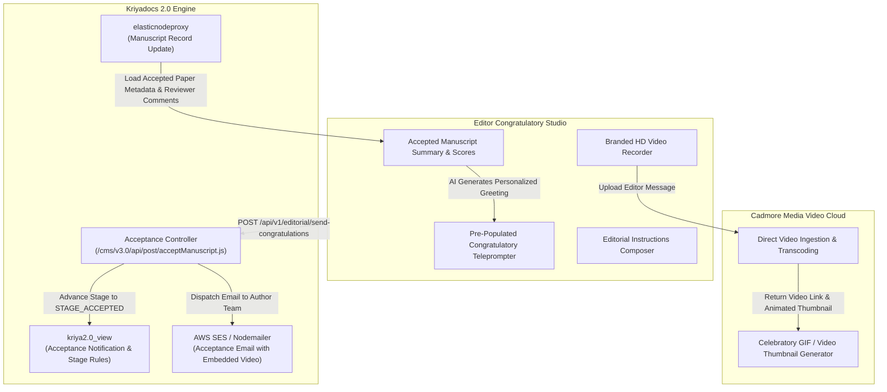
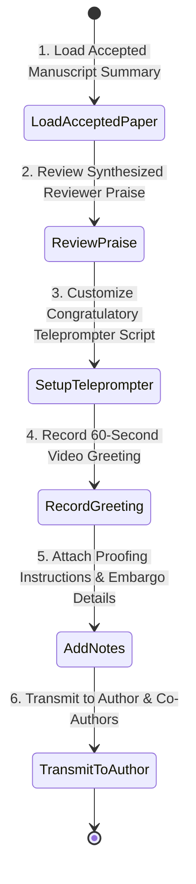

# Editor Congratulatory Studio Specification & Architectural Blueprint
## Pitch It — Humanizing Acceptance & Fostering Author-Journal Loyalty

> **Document Version**: 1.0  
> **Target Path**: `pitch-it/documents/05.editor_congratulations.md`  
> **Integrated Systems**: **Kriyadocs 2.0** (`kriya2.0`, `kriya2.0_view`, `elasticnodeproxy`) & **Cadmore Media Video Cloud**

---

## 1. Executive Overview & Purpose

The **Editor Congratulatory Studio** (`/editor-congratulations`) transforms one of the most bureaucratic moments in academic publishing—the cold, automated acceptance email—into a deeply personal, celebratory milestone.

### Core Mission:
1. **Humanize the Editorial Bond**: The Editor-in-Chief or Section Editor records a 45-to-60-second video message directly congratulating the author and their research team on their acceptance.
2. **Author Retention & Society Brand Equity**: High-impact authors frequently publish elsewhere because commercial publishers feel transactional. A warm, personal greeting builds lifelong author loyalty to the society/journal.
3. **Seamless Transition to Post-Acceptance Assets**: In the video, the editor invites the author to use Pitch It's **Author Post-Acceptance Studio** to create their Video Abstract and Lay Summary, maximizing subsequent citations.
4. **Editorial Guidance on Publishing Next Steps**: Provides key instructions on author proofing schedules, data availability deposits, and press embargo dates.

---

## 2. Alignment with Kriyadocs 2.0 Architecture



1. **Kriyadocs Stage State Machine (`STAGE_ACCEPTED`)**:
   - Triggers when all peer review milestones are complete and the Editor submits the acceptance determination.
2. **Editorial Notification Dispatcher (`kriya2.0/cms/v3.0/api/post/acceptManuscript.js`)**:
   - Instead of sending standard boilerplate text, Kriyadocs embeds Cadmore's animated video thumbnail and a personalized streaming link into the acceptance email.
3. **Multi-Tenant Journal Branding (`kriya2.0_view`)**:
   - Automatically loads publisher logos, journal colors, and font styles from `kriya2.0_view/cms/v3.0/images/` and `css/` to overlay branded borders on the editor's video.

---

## 3. What Needs to be Done: Step-by-Step User Journey



### Step 1: Accepted Manuscript Brief
- Displays manuscript title, corresponding author, co-author roster, and final peer review scores.
- Highlights quotes from reviewers (e.g., *"Groundbreaking clinical cohort analysis"*).

### Step 2: AI-Personalized Teleprompter Script
- Teleprompter pre-fills a warm, tailored 60-second message:
  > *"Hello Dr. Rostova and team. On behalf of the editorial board at BMJ Open, I am thrilled to formally accept your manuscript on Adaptive Immunotherapy. Our reviewers were especially impressed by your novel Phase II regimen..."*
- Editor can adjust wording or speak freely without the prompter.

### Step 3: Branded Webcam Recording
- Editor records webcam greeting with:
  - Live audio meter and countdown.
  - **Journal Brand Banner**: Lower-third graphic displaying *BMJ Open • Official Acceptance Notice*.
  - Instant playback review with re-record option.

### Step 4: Editorial Instructions & Publishing Directives
- Editor specifies:
  - Assigned Journal Volume & Issue target.
  - Production proof turnaround window (e.g., 48 hours).
  - Open Access license confirmation (CC-BY).
  - Call-to-action: *"Please record your Video Abstract and Lay Summary to accompany publication."*

### Step 5: Transmit to Authors
- Editor clicks **"Deliver Acceptance Package"**:
  - Video is uploaded and encoded on Cadmore.
  - Notification emails sent to all co-authors with celebratory video links.
  - Manuscript status moves to `STAGE_ACCEPTED` in Kriyadocs.

---

## 4. Innovative "Delight" Features (Ultra User-Friendly)

### 1. "AI Praise Harvester" (Auto-Drafted Greetings)
* **The Problem**: Editors accept dozens of papers and do not have time to invent custom compliments for each one.
* **Solution**: AI reads the favorable remarks from Reviewer 1 and Reviewer 2 and inserts 1 or 2 specific scientific compliments into the editor's teleprompter script. The greeting sounds deeply attentive and tailored with zero editorial effort.

### 2. Animated Video Email Teaser (Cadmore GIF Embed)
* The author receives an email featuring an animated 3-second looping GIF of the Editor smiling and speaking, with a play button overlay. Clicking the GIF opens the high-resolution streaming player.

### 3. All-Co-Author Multi-Cast
* Often only the corresponding author receives acceptance news. Pitch It automatically sends celebratory links to **every listed co-author**, letting the entire lab celebrate together.

### 4. "Journal Ambassador" Invitation
* Includes a 1-click invitation for the author to:
  - Join the journal’s advisory reviewer community.
  - Agree to participate in a journal podcast or featured press release.

---

## 5. Client-Side (Frontend) Technical Specifications

### Architecture & Tech Stack:
- **Framework**: React 19 + TypeScript
- **Styling**: Tailwind CSS
- **Icons**: Lucide React
- **Recorder**: Native WebRTC with custom Canvas brand overlays

### Key Client Modules:
```
client/src/
├── pages/
│   └── EditorCongratulatoryPage.tsx     # Main orchestrator layout
├── components/congratulations/
│   ├── AcceptedPaperHeader.tsx          # Manuscript info, DOI badge, author roster
│   ├── PraiseHarvesterCard.tsx          # Highlights positive reviewer quotes
│   ├── EditorVideoStudio.tsx            # Viewfinder with lower-third branded banner
│   ├── AcceptanceTeleprompter.tsx       # Auto-scroll script with eye-line positioning
│   └── EditorialNotesForm.tsx           # Volume, issue, proofing directives form
└── hooks/
    └── useBrandedRecorder.ts            # Draws journal lower-third graphic onto canvas stream
```

---

## 6. Server-Side (Backend) Technical Specifications

### REST API Endpoints:

| Endpoint | Method | Role | Description |
|---|---|---|---|
| `/api/v1/editorial/accepted-paper/:id` | `GET` | Editor | Fetches accepted manuscript details, reviewer praise snippets, and author contact emails. |
| `/api/v1/editorial/upload-congratulations` | `POST` | Editor | Uploads editor's video to Cadmore, generates animated GIF thumbnail, and creates streaming token. |
| `/api/v1/editorial/send-congratulations` | `POST` | Editor | Finalizes acceptance in `kriya2.0`, sends email notifications via AWS SES, and unlocks Author Post-Acceptance Studio. |

### Congratulation Dispatch Schema (`POST /api/v1/editorial/send-congratulations`):
```json
{
  "manuscriptId": "BMJ-2026-08912",
  "editorId": "ed_prof_vance",
  "editorName": "Prof. Julian Vance, Editor-in-Chief",
  "congratulatoryVideoCadmoreId": "cad_congrat_891201",
  "targetVolume": "Volume 16",
  "targetIssue": "Issue 4",
  "authorEmails": [
    "elena.rostova@oncology-inst.org",
    "keith.morris@oncology-inst.org"
  ],
  "editorialDirectives": "Please prepare your 90-second Lay Summary for our press briefing.",
  "timestamp": "2026-11-09T21:50:00Z"
}
```

---

## 7. Implementation Checklist for Developers

- [ ] **Frontend**: Build celebratory layout with manuscript summary and reviewer praise highlights.
- [ ] **Frontend**: Implement webcam recorder with customizable lower-third journal branding canvas overlay.
- [ ] **Frontend**: Build synchronized teleprompter with auto-scroll and eye-contact positioner.
- [ ] **Frontend**: Create editorial instructions form (volume, issue, proofing deadline).
- [ ] **Backend**: Integrate with `kriya2.0/cms/v3.0/api/post/acceptManuscript.js` state transition.
- [ ] **Backend**: Create email notification template in `kriya2.0_view` with Cadmore animated thumbnail embed.
- [ ] **Backend**: Unlock Stage 5 (Author Post-Acceptance Studio) permissions for author token.

