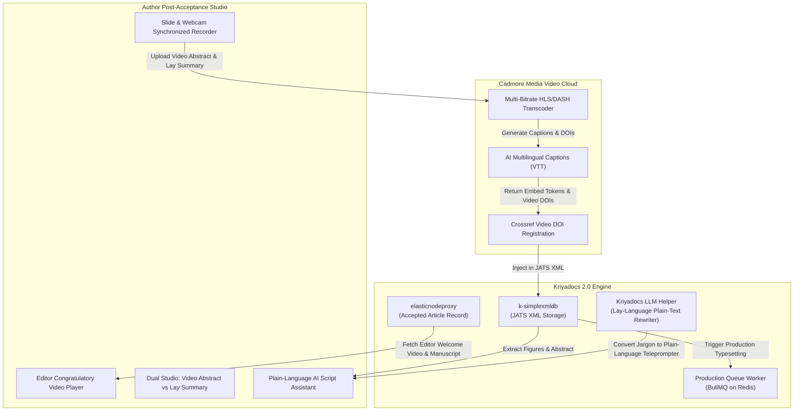
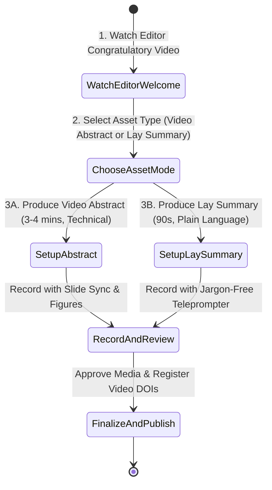

# Author Post-Acceptance Studio Specification & Architectural Blueprint
## Pitch It — Knowledge Mobilization, Video Abstracts & Plain-Language Lay Summaries

> **Document Version**: 1.0  
> **Target Path**: `pitch-it/documents/06.author_acceptance.md`  
> **Integrated Systems**: **Kriyadocs 2.0** (`kriya2.0`, `k-simplexmldb`, `elasticnodeproxy`) & **Cadmore Media Video Cloud**

---

## 1. Executive Overview & Purpose

The **Author Post-Acceptance Studio** (`/author-acceptance`) empowers researchers whose papers have been officially accepted to transform their work into high-visibility digital media assets.

### Core Mission:
1. **Bridge the Public & Scientific Divide**:
   - **Video Abstract (3–4 minutes)**: Technical, rigorous presentation tailored for fellow scientists, specialists, and academic peers.
   - **Plain-Language Lay Summary (90 seconds)**: Jargon-free narrative tailored for patients, healthcare advocates, policymakers, university press offices, and science journalists.
2. **Elevate Discovery (SEO, AEO & GEO)**: Search engines (Google) and AI answer engines (ChatGPT Search, Perplexity, Google AI Overviews) heavily prioritize video content with clean closed captions and plain-language summaries over static academic PDFs.
3. **Experience the Editor's Congratulatory Video**: Authors begin their post-acceptance journey by watching the personalized video message recorded by the journal editor.
4. **Cadmore Media Enrichment**: Automatically generates multilingual captions (WCAG 2.2 AA compliant) and registers distinct Crossref Video DOIs.

---

## 2. Alignment with Kriyadocs 2.0 Architecture



1. **JATS XML Metadata Ingestion (`k-simplexmldb`)**:
   - Fetches the finalized article text, figures, and author metadata directly from the XML repository.
   - Upon video completion, writes Crossref video DOIs and streaming URIs into `<supplementary-material mimetype="video" mime-subtype="mp4">` tags.
2. **Kriyadocs LLM Plain-Language Engine**:
   - Integrates with Kriyadocs’ internal OpenAI/LLM helper to translate complex clinical jargon into an engaging 90-second conversational script.
3. **Automated Production Handoff**:
   - Updates article status in `elasticnodeproxy` from `STAGE_ACCEPTED` to `STAGE_READY_FOR_PUBLISHING`.

---

## 3. What Needs to be Done: Step-by-Step User Journey



### Step 1: Watch the Editor's Congratulatory Video
- Author arrives on page and is greeted with a celebratory banner and the embedded personalized video from the Editor-in-Chief.

### Step 2: Dual Asset Creator Studio
Authors toggle between two dedicated recording modes:

#### Mode A: The Video Abstract (3–4 minutes)
- Intended for peer scientists.
- Synchronized with full high-resolution figures, chemical structures, and statistical curves from the accepted paper.
- Focus: Experimental setup, validation cohorts, primary endpoints, and mechanisms of action.

#### Mode B: The Lay Summary (90 seconds)
- Intended for patients, advocacy groups, educators, and journalists.
- Focus: *"What was the health problem? What did we discover? How does this help human lives?"*
- Powered by the **Plain-Language Teleprompter**.

### Step 3: Recording, Caption Review & Multilingual Translation
- Author records webcam feed with teleprompter and slide deck controls.
- Instant AI caption generation displays real-time captions.
- Option to select target caption languages (e.g., English, Spanish, French, Mandarin) generated by Cadmore STT.

### Step 4: Final Approval & Crossref Video DOI Registration
- Author clicks **"Publish Media Package"**:
  - Video files stream to Cadmore CDN.
  - Video DOIs are minted (e.g., `10.1136/bmjopen-2026-0941.v1`).
  - Package is bound to the article XML and routed to the journal hosting platform.

---

## 4. Innovative "Delight" Features (Ultra User-Friendly)

### 1. "AI Jargon Buster" for Lay Summaries
* **The Problem**: Academic researchers struggle to stop using heavy scientific acronyms (e.g., *"pharmacokinetics"*, *"monoclonal immunogenicity"*).
* **Solution**: While drafting the lay summary script, the system highlights complex jargon in yellow and suggests everyday alternatives:
  - *"Pharmacokinetic clearance"* $\rightarrow$ *"How fast the body processes the medication"*.
  - *"Statistically significant p < 0.001"* $\rightarrow$ *"Strong proof that the treatment was effective"*.

### 2. Auto-Generated Social Media Teaser Clips
* Pitch It automatically extracts the most compelling 30-second highlight clip, adds burned-in subtitles, and formats it for LinkedIn, X (Twitter), and university press office distribution.

### 3. Funder & Grant Visibility Tagging
* Authors can tag their research funders (e.g., NIH, Wellcome Trust, ERC, Horizon Europe).
* Video metadata is enriched with grant numbers, satisfying open science public-outreach mandates.

### 4. Co-Author Collaborative Review
* Corresponding author can send a private preview link to all lab co-authors for 1-click approval before publishing the video.

---

## 5. Client-Side (Frontend) Technical Specifications

### Architecture & Tech Stack:
- **Framework**: React 19 + TypeScript
- **Styling**: Tailwind CSS
- **Icons**: Lucide React
- **Player & Captions**: Cadmore Universal Player with VTT track renderer

### Key Client Modules:
```
client/src/
├── pages/
│   └── AuthorPostAcceptancePage.tsx     # Main orchestrator layout
├── components/acceptance/
│   ├── EditorWelcomeCard.tsx            # Editor congratulation player & celebration banner
│   ├── AssetModeTabs.tsx                # Toggle between 'Video Abstract' & 'Lay Summary'
│   ├── JargonBusterEditor.tsx           # Script editor with plain-language suggestions
│   ├── ProductionVideoStudio.tsx        # Slide presenter + WebRTC recorder
│   ├── MultilingualCaptionsPreview.tsx  # Multi-language subtitle reviewer
│   └── PublishApprovalModal.tsx         # Crossref DOI confirmation & submission modal
└── hooks/
    ├── useJargonOptimizer.ts            # Client-side readability scoring (Flesch-Kincaid)
    └── useProductionUploader.ts         # High-resolution video chunk upload to Cadmore
```

---

## 6. Server-Side (Backend) Technical Specifications

### REST API Endpoints:

| Endpoint | Method | Role | Description |
|---|---|---|---|
| `/api/v1/acceptance/session/:manuscriptId` | `GET` | Author | Fetches accepted paper metadata, editor congratulatory video URL, and manuscript figures. |
| `/api/v1/acceptance/generate-lay-script` | `POST` | Author | Uses LLM to translate technical abstract into a 90-second conversational lay script. |
| `/api/v1/acceptance/upload-post-acceptance-media`| `POST` | Author | Uploads Video Abstract / Lay Summary blobs directly to Cadmore S3 ingestion. |
| `/api/v1/acceptance/finalize-assets` | `POST` | Author | Registers Crossref video DOIs via Cadmore API and updates JATS XML via `k-simplexmldb`. |

### Finalize Assets Payload (`POST /api/v1/acceptance/finalize-assets`):
```json
{
  "manuscriptId": "BMJ-2026-08912",
  "videoAbstract": {
    "cadmoreId": "cad_va_891204",
    "durationSeconds": 218,
    "doi": "10.1136/bmjopen-2026-0941.va",
    "captions": ["en", "es", "fr"]
  },
  "laySummary": {
    "cadmoreId": "cad_ls_891205",
    "durationSeconds": 88,
    "doi": "10.1136/bmjopen-2026-0941.ls",
    "captions": ["en", "es"]
  },
  "funderGrantNumbers": ["NIH-NCI-R01CA248102"],
  "timestamp": "2026-11-09T21:55:00Z"
}
```

---

## 7. Implementation Checklist for Developers

- [ ] **Frontend**: Build celebratory header with embedded editor congratulatory player.
- [ ] **Frontend**: Implement tabbed studio switching between Video Abstract and Lay Summary.
- [ ] **Frontend**: Integrate AI Jargon Buster script assistant with readability meter.
- [ ] **Frontend**: Build multi-language subtitle selector and VTT previewer.
- [ ] **Backend**: Implement `/api/v1/acceptance/generate-lay-script` using Kriyadocs LLM utilities.
- [ ] **Backend**: Integrate Cadmore Crossref Video DOI registration API.
- [ ] **Backend**: Update JATS XML `<supplementary-material>` in `k-simplexmldb`.

