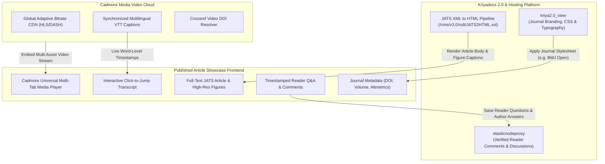
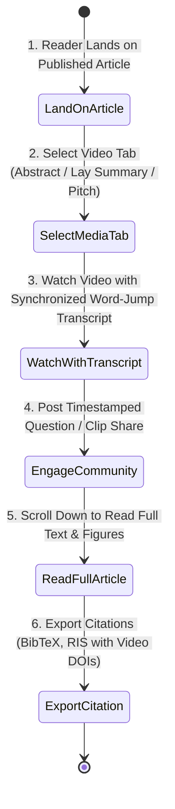

# Published Article Showcase Specification & Architectural Blueprint
## Pitch It — Multi-Format Video Player, Interactive Discovery & Audience Engagement

> **Document Version**: 1.0  
> **Target Path**: `pitch-it/documents/07.published_showcase.md`  
> **Integrated Systems**: **Kriyadocs 2.0** (`kriya2.0`, `kriya2.0_view`, JATS XML Engine) & **Cadmore Media Video Cloud**

---

## 1. Executive Overview & Purpose

The **Published Article Showcase** (`/published-preview`) is the ultimate public-facing destination of the scientific work. It transforms traditional, flat, text-heavy academic publishing into a dynamic, accessible multimedia knowledge hub.

### Core Mission:
1. **Multi-Format Video Experience**: Integrates Cadmore's universal scholarly video player featuring a seamless **3-tab switcher**:
   - **Tab 1: Video Abstract (3–4 min)**: Deep technical exploration for peer scientists.
   - **Tab 2: Lay Summary (90 sec)**: Plain-language overview for patients, students, journalists, and policymakers.
   - **Tab 3: Original Submission Pitch**: Transparent archival look at the author's initial pitch to the editorial board.
2. **Generative Engine (GEO) & Answer Engine (AEO) Optimization**: Synchronized video captions, transcripts, and plain-language summaries allow AI search engines (Perplexity, ChatGPT Search, Google AI Overviews) to index, cite, and surface the research accurately.
3. **Accessibility Compliance (WCAG 2.2 AA & Section 508)**: Full keyboard navigation, multi-language closed captions, high-contrast controls, and synchronized screen-reader text.
4. **Community Discourse & Author Dialogue**: Interactive, timestamped discussions between readers and verified authors.

---

## 2. Alignment with Kriyadocs 2.0 Architecture



1. **JATS XML Transformation Pipeline (`kriya2.0/cms/v3.0/xslt`)**:
   - Uses Kriyadocs’ native XSLT stylesheets to render the full text, equations, and high-resolution figures beneath the video player.
2. **Publisher Theming (`kriya2.0_view`)**:
   - Dynamically loads publisher brand guidelines, banner logos, and color palettes from `kriya2.0_view/cms/v3.0/css/` (e.g., BMJ Cyan accents, Open Access badges).
3. **Crossref Video DOI Resolution**:
   - Both the text article DOI (`10.1136/bmjopen-2026-0941`) and individual Video DOIs are linked to ensure persistent archival citations.

---

## 3. What Needs to be Done: Step-by-Step User Journey



### Step 1: High-Impact Article Header
- Displays journal volume/issue, article title, author list with ORCID links, and Open Access license.
- Real-time impact indicators: Altmetric attention score, video view count, citation metrics.

### Step 2: Cadmore Multi-Tab Media Player
- Centered above the article abstract with instant tab switching:
  - `Video Abstract (3m 45s)`
  - `Lay Summary (Plain-Language 90s)`
  - `Original Submission Pitch`
- Controls: Play/pause, speed selector (0.75x to 2x), resolution picker (1080p, 720p, 480p), full-screen, picture-in-picture.

### Step 3: Interactive Word-by-Word Synchronized Transcript
- Live transcript window below the player:
  - Highlights currently spoken words in real time.
  - **Click-to-Seek**: Clicking any sentence jumps the video immediately to that exact second.
  - Search box: Type any keyword (e.g., *"pancreatic"*, *"p-value"*) to highlight all occurrences on the timeline.

### Step 4: Community Discourse & Author Q&A
- Readers can post comments or ask clarifying questions:
  - Verified Researcher badge (authenticated via ORCID).
  - Authors reply with distinct **"Author / Investigator"** badge.
  - Questions can be linked to video timestamps (e.g., *"At 2:15, what was the dosage?"*).

---

## 4. Innovative "Delight" Features (Ultra User-Friendly)

### 1. 15-Second Video Clip & Social Share Creator
* Readers can select any 15-second snippet of the Video Abstract or Lay Summary, click **"Share Clip"**, and generate an embeddable card with burned-in subtitles for LinkedIn, X (Twitter), or Bluesky.

### 2. "Lay Summary vs Scientific View" Quick Toggle
* A toggle at the top of the article:
  - **Scientific View**: Displays the Video Abstract, technical abstract, and full experimental data.
  - **Public / Patient View**: Prominently spotlights the 90-second Lay Summary, plain-language takeaway boxes, and clinical implications.

### 3. Unified Video + Text Citation Exporter
* The **"Cite this Article"** button exports citations in APA, Chicago, BibTeX, and RIS formats, citing both the primary article DOI and the dedicated Cadmore Video DOI.

### 4. Interactive Slide-to-Figure Cross-Referencing
* Clicking a slide thumbnail in the Video Abstract instantly scrolls the page down to the corresponding high-resolution figure and raw data table in the full text.

---

## 5. Client-Side (Frontend) Technical Specifications

### Architecture & Tech Stack:
- **Framework**: React 19 + TypeScript
- **Styling**: Tailwind CSS
- **Icons**: Lucide React
- **Player**: Cadmore Universal Player SDK with custom React wrapper

### Key Client Modules:
```
client/src/
├── pages/
│   └── PublishedArticleViewPage.tsx    # Main showcase layout
├── components/showcase/
│   ├── ArticleHeroHeader.tsx           # Journal volume, title, DOI, author links
│   ├── CadmoreTabbedPlayer.tsx         # Multi-tab player (Abstract, Lay Summary, Pitch)
│   ├── InteractiveTranscriptView.tsx   # Word-by-word synchronized clickable transcript
│   ├── SocialClipModal.tsx             # 15-second snippet creator & social sharing
│   ├── CommunityDiscussion.tsx         # Timestamped questions & author verified replies
│   └── CitationExportModal.tsx         # BibTeX / RIS exporter with video DOIs
└── hooks/
    ├── useCadmoreSync.ts               # Video timeupdate synchronizer for transcript highlighting
    └── useArticleDiscussion.ts         # Q&A posting and live comment stream
```

---

## 6. Server-Side (Backend) Technical Specifications

### REST API Endpoints:

| Endpoint | Method | Role | Description |
|---|---|---|---|
| `/api/v1/public/article/:doi` | `GET` | Public | Returns published article JATS XML/HTML, Cadmore video stream tokens, and VTT transcripts. |
| `/api/v1/public/comments/:manuscriptId` | `GET` | Public | Fetches timestamped reader comments, questions, and verified author replies. |
| `/api/v1/public/comments` | `POST` | Verified User| Posts reader question with video timestamp; notifies author via Kriyadocs notification service. |
| `/api/v1/public/generate-clip` | `POST` | Public | Queues a 15-second branded video clip cut with subtitles for social media sharing. |

### Public Article Media Payload (`GET /api/v1/public/article/:doi`):
```json
{
  "doi": "10.1136/bmjopen-2026-0941",
  "journal": "BMJ Open",
  "title": "Adaptive Dose-Escalation Immunotherapy in Refractory Pancreatic Cancer: Phase II Results",
  "authors": [
    { "name": "Dr. Elena Rostova", "orcid": "0000-0002-1825-0097", "isCorresponding": true },
    { "name": "Prof. Julian Vance", "orcid": "0000-0003-9102-4411" },
    { "name": "Dr. Keith Morris", "orcid": "0000-0001-7782-9902" }
  ],
  "mediaStreams": {
    "videoAbstract": {
      "cadmoreEmbedUrl": "https://player.cadmore.media/embed/bmjopen_2026_va_8912",
      "duration": "3m 45s",
      "captionsUrl": "https://stream.cadmore.media/captions/va_8912.vtt",
      "doi": "10.1136/bmjopen-2026-0941.va"
    },
    "laySummary": {
      "cadmoreEmbedUrl": "https://player.cadmore.media/embed/bmjopen_2026_ls_8912",
      "duration": "1m 30s",
      "captionsUrl": "https://stream.cadmore.media/captions/ls_8912.vtt",
      "doi": "10.1136/bmjopen-2026-0941.ls"
    },
    "originalPitch": {
      "cadmoreEmbedUrl": "https://player.cadmore.media/embed/bmjopen_2026_pitch_8912",
      "duration": "2m 14s",
      "captionsUrl": "https://stream.cadmore.media/captions/pitch_8912.vtt"
    }
  },
  "publishedDate": "2026-11-09T00:00:00Z"
}
```

---

## 7. Implementation Checklist for Developers

- [ ] **Frontend**: Build BMJ/Nature style academic article showcase layout with high-contrast typography.
- [ ] **Frontend**: Implement Cadmore tab switcher (`Video Abstract`, `Lay Summary`, `Original Pitch`).
- [ ] **Frontend**: Build word-by-word synchronized interactive transcript with live search and click-to-seek.
- [ ] **Frontend**: Implement 15-second social media clip generator modal.
- [ ] **Frontend**: Build timestamped community discussion board with verified author badges.
- [ ] **Backend**: Connect `/api/v1/public/article/:doi` to fetch from `k-simplexmldb` and `elasticnodeproxy`.
- [ ] **Backend**: Implement citation exporter supporting Crossref Video DOIs in BibTeX and RIS.

