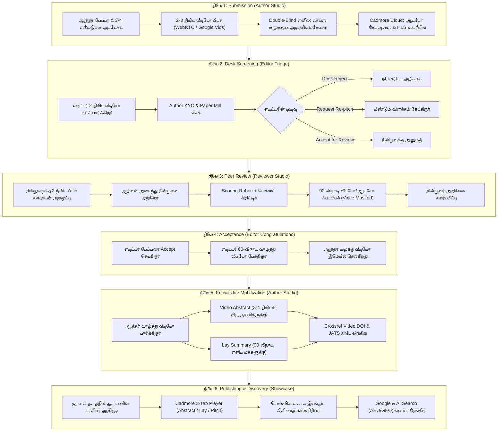

# Pitch It — முழுமையான Start-to-End Workflow (ஆரம்பம் முதல் முடிவு வரை)

> **கோப்புப் பெயர்**: `pitch-it/docs/08.end_to_end_workflow.md`  
> **நோக்கம்**: ஒரு ரிசர்ச் பேப்பர் சப்மிட் ஆவதில் தொடங்கி, எடிட்டர் ஸ்கிரீனிங், பியர் ரிவியூ, வாழ்த்துச் செய்தி, மற்றும் பப்ளிஷிங் வரை நடக்கும் முழு செயல்முறையையும் (End-to-End Journey) எளிமையான தமிழில் விளக்குதல்.

---

## 1. ஒரே பார்வையில் முழு செயல்முறை (High-Level Architecture)

---

## நிலை 1: Author Submission Studio (ஆத்தர் சப்மிட் செய்யும் கட்டம்)
* **யார் செய்வார்கள்?** ஆய்வுக் கட்டுரையை எழுதிய ஆத்தர் (Corresponding Author).
* **எந்த பக்கத்தில்?** `/` அல்லது `/author-studio`

### என்ன நடக்கும்?
1. **உள்நுழைவு (Launch):** ஆத்தர் Kriyadocs போர்ட்டலில் இருந்து Pitch It ஸ்டுடியோவுக்குள் நுழைகிறார்.
2. **டெம்ப்ளேட் தேர்வு:** தங்களது ஆய்வு வகைக்கேற்ப (Clinical Trial, Basic Science, போன்ற) ஒரு டெம்ப்ளேட்டைத் தேர்ந்தெடுக்கிறார். அதில் எந்தெந்த ஸ்லைடில் என்னென்ன பேச வேண்டும் என்ற வழிகாட்டுதல் இருக்கும்.
3. **வீடியோ தயாரிப்பு (Live Camera அல்லது Google Vids):**
   * ஆத்தர் பிரவுசர் வெப்கேம் முன்னாடி அமர்ந்து, தங்களது 3-4 முக்கிய ஸ்லைடுகளைக் காட்டி 2 முதல் 3 நிமிடத்திற்கு சுருக்கமாகப் பேசுகிறார்.
   * *(அல்லது அப்ஸ்ட்ராக்ட்டைக் கொடுத்து Google Vids மூலம் உருவாக்கப்பட்ட AI வீடியோவையும் இங்கே இணைக்கலாம்).*
4. **அடையாள மறைப்பு (Double-Blind Anonymization):**
   * ஜர்னல் இரட்டை மறைமுக (Double-blind) முறையைக் கடைப்பிடித்தால், சிஸ்டம் ஆத்தரின் குரலை மாற்றி (Pitch-shift), முகத்தை சிலுயட்/பிளர் மாஸ்க் செய்துவிடும். இதனால் பாரபட்சமற்ற மதிப்பீடு உறுதியாகிறது.
5. **Cadmore கிளவுட் அப்லோட்:** வீடியோ முடிந்ததும் Cadmore மீடியா கிளவுடில் பதிவேற்றப்பட்டு, தானாகவே AI சப்டைட்டில்ஸ் (Captions) உருவாகி எடிட்டரின் பார்வைக்குத் தயாராகிறது.

---

## நிலை 2: Editor Triage Dashboard (எடிட்டரின் முதல் கட்டப் பரிசீலனை)
* **யார் செய்வார்கள்?** ஜர்னல் தலைமை எடிட்டர் அல்லது அசோசியேட் எடிட்டர்.
* **எந்த பக்கத்தில்?** `/editor-triage`

### என்ன நடக்கும்?
1. **நேர விரயம் தவிர்ப்பு:** எடிட்டர் உடனடியாக 40 பக்க அடர்த்தியான PDF-ஐ படிக்க வேண்டிய அவசியமில்லை. வரிசையில் உள்ள பேப்பரைத் தேர்வு செய்து, ஆத்தர் பேசிய **2 நிமிட வீடியோ பிட்சை** மட்டும் பார்க்கிறார்.
2. **Author KYC & Paper Mill சோதனை:**
   * வீடியோவில் பேசுபவர் நிஜமான ஆய்வாளர் தானா?
   * AI-ஆல் உருவாக்கப்பட்ட போலி ஆய்வுக் கட்டுரையா (Paper Mill)? என்பதை ஆத்தரின் பேச்சு மற்றும் ORCID விவரங்கள் மூலம் எடிட்டர் உறுதி செய்கிறார்.
3. **எடிட்டரின் 1-கிளிக் முடிவு:**
   * **Accept for Review:** ஆய்வில் நல்ல செய்தி இருக்கிறது எனில், அடுத்த கட்ட பியர் ரிவியூவுக்கு அனுப்புகிறார்.
   * **Request Re-pitch:** ஏதேனும் புள்ளிவிவரங்கள் புரியவில்லை என்றால், ஆத்தரிடம் "இதை விளக்கி மறுபடியும் ஒரு சிறிய வீடியோ அனுப்புங்கள்" எனக் கேட்கிறார்.
   * **Desk Reject:** ஜர்னல் எல்லைக்குள் வரவில்லை என்றால், உடனடியாக கண்ணியமான காரணத்தைத் தேர்வு செய்து நிராகரிக்கிறார்.

---

## நிலை 3: Reviewer Evaluation Studio (பியர் ரிவியூ மதிப்பீடு)
* **யார் செய்வார்கள்?** வெளிப்பக்க பேராசிரியர்கள் / துறை நிபுணர்கள் (Peer Reviewers).
* **எந்த பக்கத்தில்?** `/reviewer-feedback`

### என்ன நடக்கும்?
1. **மகிழ்ச்சியான அழைப்பு:** ரிவியூவருக்கு ஈமெயில் அழைப்பு போகும்போதே, "முழு பேப்பரையும் படிக்கும் முன், இந்த 2 நிமிட வீடியோ பிட்சைப் பாருங்கள்" என லிங்க் போகும். அதைப்பார்த்து எளிதில் புரிந்து கொண்டு ரிவியூ செய்ய உடனே சம்மதிக்கிறார்.
2. **அடையாளம் காக்கப்படும் வீடியோ:** Double-blind ஜர்னல் என்றால், ரிவியூவருக்கு ஆத்தரின் முகமூடி அணிந்த, குரல் மாற்றப்பட்ட வீடியோ மட்டுமே தெரியும்.
3. **மதிப்பீட்டு மதிப்பெண்கள் (Rubric Scoring):** ஆய்வின் தரம், நம்பகத்தன்மை, புதிய கண்டுபிடிப்பு ஆகியவற்றிற்கு ஸ்லைடர்கள் மூலம் மதிப்பெண் வழங்குகிறார்.
4. **மனிதநேயமிக்க 90-செகண்ட் ஃபீட்பேக் (Humanized Feedback):**
   * தட்டச்சு செய்து பெரிய கட்டுரை எழுதுவதற்குப் பதிலாக, மைக் முன்னாடி உட்கார்ந்து **90 விநாடிகளுக்கு தன் வாய்ஸிலேயே சுட்டிக்காட்டி பேசுகிறார்**.
   * ரிவியூவரின் குரலும் மாடுலேட் செய்யப்பட்டு ஆத்தருக்குச் செல்லும்; இதனால் கடுமையான எழுத்துப்பிழையான தவறான புரிதல்கள் தவிர்க்கப்பட்டு ஆக்கப்பூர்வமான கருத்துப் பரிமாற்றம் நடக்கும்.

---

## நிலை 4: Editor Congratulatory Studio (வெற்றி தரும் வாழ்த்துச் செய்தி)
* **யார் செய்வார்கள்?** ஜர்னல் எடிட்டர்.
* **எந்த பக்கத்தில்?** `/editor-congratulations`

### என்ன நடக்கும்?
1. **பாரம்பரிய மெயில்களுக்கு விடைகொடுப்போம்:** வழக்கமாக வரும் உயிரற்ற "Your manuscript has been accepted" என்ற ஆட்டோமேட்டிக் மெயிலுக்குப் பதிலாக, எடிட்டர் ஒரு **60-விநாடி தனிப்பட்ட வாழ்த்து வீடியோவை** கேமரா முன் பேசி ரெக்கார்ட் செய்கிறார்.
2. **AI Teleprompter உதவி:** ரிவியூவர்கள் பாராட்டிய முக்கிய வரிகளை AI எடுத்துத் தந்துவிடும்; எடிட்டர் ஜர்னலின் அதிகாரப்பூர்வ லோகோவுடன் வாழ்த்துப் பேசி, அடுத்தகட்ட பப்ளிஷிங் வழிகாட்டல்களை வழங்குகிறார்.
3. **அனைத்து ஆத்தர்களுக்கும் சென்றடைதல்:** முதன்மை ஆத்தர் மட்டுமின்றி, ஆய்வில் உழைத்த அனைத்து இணை-ஆத்தர்களுக்கும் (Co-authors) இந்த வாழ்த்து வீடியோ இமெயிலில் செல்கிறது.

---

## நிலை 5: Author Post-Acceptance Studio (அறிவை உலகிற்குப் பகிர்தல்)
* **யார் செய்வார்கள்?** ஆய்வுக் கட்டுரை ஏற்றுக்கொள்ளப்பட்ட ஆத்தர்.
* **எந்த பக்கத்தில்?** `/author-acceptance`

### என்ன நடக்கும்?
1. **எடிட்டரின் வாழ்த்தைப் பார்த்தல்:** ஆத்தர் மகிழ்ச்சியுடன் எடிட்டரின் வாழ்த்து வீடியோவைப் பார்க்கிறார்.
2. **இரண்டு புதிய வீடியோக்களைத் தயாரித்தல்:**
   * **1. Video Abstract (3 முதல் 4 நிமிடங்கள்):** மற்ற விஞ்ஞானிகளுக்காக முழு ஆய்வு விளக்கப்படங்கள் மற்றும் முடிவுகளை ஆழமாக விளக்கும் வீடியோ.
   * **2. Lay Summary (90 விநாடிகள்):** சாதாரண மக்களுக்கும் நோயாளிகளுக்கும் புரியும் வகையில் எளிய தமிழில்/ஆங்கிலத்தில் விளக்கும் வீடியோ. (இதற்கு AI Jargon Buster கடினமான மருத்துவ வார்த்தைகளை எளிய வார்த்தைகளாக மாற்றித் தரும்).
3. **டிஜிட்டல் முத்திரை (Crossref Video DOI):** இந்த வீடியோக்களுக்கு சர்வதேச வீடியோ அடையாள எண் (DOI) உருவாக்கப்பட்டு, Kriyadocs-ன் அதிகாரப்பூர்வ JATS XML ஆவணத்தில் நிரந்தரமாக இணைக்கப்படுகிறது.

---

## நிலை 6: Published Article Showcase (உலகளாவிய வெளியீடு & வாசகர் பார்வை)
* **யார் செய்வார்கள்?** உலகெங்கிலும் உள்ள வாசகர்கள், நோயாளிகள், மாணவர்கள், மற்றும் ஆராய்ச்சியாளர்கள்.
* **எந்த பக்கத்தில்?** `/published-preview`

### என்ன நடக்கும்?
1. **நவீன பப்ளிஷிங் அனுபவம்:** ஜர்னல் தளத்தில் (BMJ Open, Nature போன்றவை) ஆர்ட்டிகிள் வெளியாகும் போது, வெறும் போரிங் PDF ஆக இல்லாமல் மேலே **Cadmore 3-Tab வீடியோ பிளேயருடன்** மிளிரும்:
   * Tab 1: Video Abstract
   * Tab 2: Lay Summary
   * Tab 3: Original Pitch
2. **சொல்-சொல்லாக நகரும் இன்டராக்டிவ் டிரான்ஸ்கிரிப்ட்:** வீடியோ ஓடும்போதே கீழே சப்டைட்டில் வார்த்தைகள் ஹைலைட் ஆகும்; ஏதேனும் ஒரு வரியைக் கிளிக் செய்தால் வீடியோ நேராக அந்த நொடிக்குத் தாவும்!
3. **15-செகண்ட் சோசியல் மீடியா ஷேர்:** வாசகர்கள் தங்களுக்குப் பிடித்த 15 விநாடி வீடியோ பகுதியை மட்டும் கட் செய்து லிங்க்டுஇன், எக்ஸ் (Twitter)-ல் ஷேர் செய்யலாம்.
4. **AI & கூகுளில் முதலிடம் (AEO / GEO):** வீடியோ மற்றும் தெளிவான சுருக்கம் இருப்பதால், கூகுள் தேடலிலும் ChatGPT, Perplexity போன்ற AI கருவிகளிலும் இந்த ஆய்வு மிக எளிதாகக் கண்டறியப்பட்டு பல மடங்கு வாசகர்களைச் சென்றடையும்!

---

## சம்மரி (ஒரு வரிச் சுருக்கம்):
> **Pitch It** என்பது ஆத்தர் பேப்பரை வீடியோவாக சப்மிட் செய்வதில் தொடங்கி $\rightarrow$ எடிட்டர் 2 நிமிடத்தில் பரிசீலித்து $\rightarrow$ ரிவியூவர் சுலபமாக வீடியோ ஃபீட்பேக் தந்து $\rightarrow$ பேப்பர் வென்றதும் எடிட்டர் வாழ்த்தி $\rightarrow$ உலக மக்கள் அனைவரும் எளிதில் புரிந்துகொள்ளும் வகையில் வீடியோக்களுடன் இணையத்தில் பப்ளிஷ் ஆகும் **முழுமையான, புரட்சிகரமான வீடியோ பப்ளிஷிங் சுழற்சி!**

