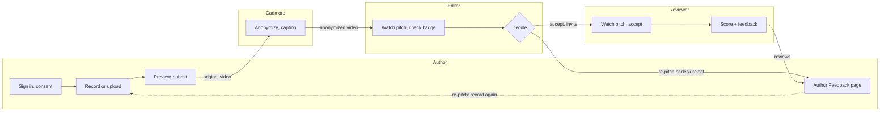

# Pitch It — Product Requirements Document

Nov 11, 2026 · Jegannathan

Kriyadocs & Cadmore Joint Innovation Team

> Source of truth: the Claude Doc at https://claude.ai/artifact/BC8YK3qTwyYX7FDHNm6Fzo. This file is a Markdown copy.

## Summary

Pitch It lets an author submit a 2–3 minute video pitch with their manuscript, so editors triage faster and reviewers decide sooner whether to accept an invitation. It runs inside the peer review platforms journals already use (Kriyadocs portal, Editorial Manager, ScholarOne), and Cadmore Media stores, anonymizes and streams every video.

R1 (first release) ships:

- **Author Studio:** record live or upload a pitch with synced slides, with accessible alternatives (audio + slides, slides + script)
- **Identity check (KYC):** ORCID sign-in, institutional email check and live-recording signal, shown to editors as a green or amber badge
- **Double-blind support:** a server-made anonymized version (neutral avatar and voice) is the only version reviewers ever receive
- **Editor Dashboard:** one page to watch the pitch, decide (Accept for Review, Request Re-pitch, Desk Reject) and invite reviewers
- **Reviewer Page:** watch the pitch, accept or decline, score on 4 criteria and leave anonymized video, audio or written feedback
- **Author Feedback page:** decision, editor note and reviewer feedback in one place

Post-acceptance videos (video abstract, lay summary, editor congratulations, public player) follow in R2.

Every number in this PRD is labelled **Sourced** (public data with a link), **Derived** (calculated by us) or **To confirm** (needs our own data or a partner decision). The full product description is in `docs/08.product_overview.md`.

## Problem and opportunity

Publishers spend editor and reviewer time on manuscripts that should never reach review, while genuine authors have no way to show why their work matters.

**Publisher pain**

- **AI-generated submissions and paper mills:** no lightweight way to check that a real, verified researcher stands behind a submission
- **Submission volume:** desk screening takes days per manuscript **[To confirm: baseline from Kriyadocs publisher data]**
- **Slow screening:** editors must read the manuscript to grasp its core idea
- **Low reviewer acceptance:** editors invite several reviewers to secure two **[To confirm: baseline]**
- **Weak discoverability:** articles lack captions, transcripts and plain-language summaries that AI search engines can use

**Author pain**

- No channel to explain why the research is meaningful before an editor decides
- Desk rejections and reviews often arrive as short text with little guidance
- Little visibility after publication beyond the PDF

**Opportunity:** a short, verified video pitch at submission gives editors a faster first signal, gives reviewers a reason to accept, and gives authors a voice. The same recording pipeline later produces video abstracts and lay summaries (R2).

## Users and roles

Six roles use Pitch It; each works in at most two pages, and only the Editor-in-Chief can see an un-anonymized video in a double-blind journal.

| Role | Comes from | Signs in with | Pages |
| --- | --- | --- | --- |
| Author | Submission form on the peer review platform | ORCID or verified email | Author Studio, Author Feedback |
| Editor | Journal editorial board, already set up on the platform | Platform login | Editor Dashboard |
| Editor-in-Chief | Journal editorial board | Platform login | Editor Dashboard (plus access to original videos) |
| Reviewer (existing) | Journal reviewer list or author suggestions | Secure invitation link or reviewer dashboard | Reviewer Page |
| Reviewer (new) | Added by the editor by name and email; a temporary guest account is created | Secure invitation link, no password | Reviewer Page |
| Publisher admin | Publisher staff | Platform admin login | Pitch It settings tab |

**Co-authors:** one presenter per pitch in R1 (the corresponding author or a chosen submitting co-author). Co-authors can watch the pitch on the peer review platform before it is submitted. Multi-author recording is R2.

**What each role gets**

| Role | Experience goal | Acceptance check |
| --- | --- | --- |
| Author | Present the research in their own words, safely, in under 10 minutes | Can record, preview and submit a pitch without leaving one page |
| Editor | Make a confident first decision without opening the manuscript | Pitch, identity badge, decision and reviewer invite all on one page |
| Reviewer | Decide on an invitation in about 3 minutes | Pitch plays from the email link with no login |
| Publisher admin | Set journal rules once | All Pitch It rules in one settings tab |

The 10-minute and 3-minute targets are **To confirm** in usability tests.

## Goals, non-goals and success metrics

R1 succeeds if more than 60% of pilot submissions include a verified pitch and editors reach a first decision 50% faster on those manuscripts.

**Goals**

1. Verify that a real researcher stands behind each pitched submission
2. Help editors decide at triage whether a manuscript merits review
3. Help reviewers decide whether to accept an invitation
4. Let editors and reviewers send constructive feedback the author can act on
5. Protect identities in single-blind and double-blind review

**Success metrics**

| Metric | Target | Label |
| --- | --- | --- |
| Submissions with a pitch | > 60% in the pilot | To confirm |
| Pitches with verified identity (ORCID + institutional domain) | > 95% | To confirm |
| Authors who open the studio and submit a pitch | ≥ 85% | To confirm |
| Time to first editor decision, pitched vs. unpitched | 50% faster | Derived |
| Reviewer invitation acceptance | From about 20–28% to 35–40% | To confirm (baseline reported by Publons, not yet verified) |
| Time to first decision overall | 15–20% faster | To confirm |
| Reviews with spoken feedback (video or audio) | ≥ 25% | To confirm |

**Non-goals for R1**

- Post-acceptance videos: video abstract, lay summary, video article, editor congratulations
- Public video player on the published article
- AI deepfake detection and Presubmit integrity cross-checks
- Multi-author recording
- Languages other than English
- Replacing the peer review platform's own user accounts or emails

## Scope and requirements

R1 adds 4 new pages and 1 settings tab; smaller steps open as popup windows or side panels so no user moves through more than two pages in R1. R2 adds 3 more pages for the post-acceptance videos (listed below).

**List rule:** any list in Pitch It (editor queue, reviewer history, author manuscript switcher) shows 10 items per page. Pagination controls (Previous, page numbers, Next) appear only when a list has more than 10 items.

| Name | Type | Used by |
| --- | --- | --- |
| Pitch It settings | Tab in the existing journal settings page | Publisher admin |
| Author Studio | Page | Author |
| Editor Dashboard | Page | Editor, Editor-in-Chief |
| Reviewer Page | Page | Reviewer |
| Author Feedback | Page | Author |
| Video abstract & lay summary | Page (R2) | Author |
| Congratulations | Page (R2) | Editor |
| Published article | Page (R2) | Reader |

### FR-1 Pitch It settings (tab)

| ID | Requirement |
| --- | --- |
| FR-1.1 | Admin sets the review type: open, single-blind or double-blind |
| FR-1.2 | Admin sets the pitch as mandatory, optional or not needed, per article type. Defaults: Original Research and Clinical Trial mandatory; Review Article and Case Report optional; Letter and Erratum not needed |
| FR-1.3 | Admin sets limits: author pitch ≤ 180 s, reviewer feedback ≤ 90 s, editor note ≤ 60 s, ≤ 1080p, ≤ 150 MB |
| FR-1.4 | Admin sets the reviewer link expiry (default 14 days) |
| FR-1.5 | Admin edits the reviewer scoring criteria (4 defaults, 1–5 scale) |
| FR-1.6 | Admin sets reminder email timing **[To confirm]** |
| FR-1.7 | Admin connects the peer review platform: Kriyadocs portal, Editorial Manager or ScholarOne |
| FR-1.8 | Admin sets re-pitch rules: maximum re-pitches per manuscript (default 1) and author deadline (default 7 days) |
| FR-1.9 | Admin sees the Cadmore connection status and sets the video resolution preset, delivery region and automatic captions **[To confirm with Cadmore]** |
| FR-1.10 | Admin sets whether the pitch is included in reviewer invitations by default (on by default); editors can change it per manuscript (FR-3.8) |

### FR-2 Author Studio (page)

| ID | Requirement |
| --- | --- |
| FR-2.1 | Opens from a "Record Pitch" button on the submission form, with a secure link carrying manuscript ID, journal and author |
| FR-2.2 | Sign-in popup: ORCID sign-in, plus an institutional email domain check; personal emails (for example @gmail.com) are accepted |
| FR-2.3 | Consent popup: author agrees to recording, identity check and storage (GDPR) before any recording |
| FR-2.4 | Two tabs: **Record** (live in the browser) and **Upload** (.mp4 or .webm) |
| FR-2.5 | Alternatives: audio + slides; slides + written script read aloud by text-to-speech |
| FR-2.6 | Pitch templates and an on-screen script (teleprompter) |
| FR-2.7 | Slide upload (PDF or PPTX), shown as 5–8 slides synced with the video |
| FR-2.8 | Timer showing time left; recording stops at the journal limit |
| FR-2.9 | Double-blind journals: live preview of the neutral avatar and neutral voice; personalized avatars and voices are not offered |
| FR-2.10 | Single-blind and open journals: real face and voice by default; avatars and voice styles optional |
| FR-2.11 | Double-blind journals: on-screen warnings not to mention institution, lab, grant numbers or past papers |
| FR-2.12 | Double-blind journals: automatic scan of slides and uploaded videos for names, emails, logos and watermarks, shown to the author as a soft warning, not a block; the author can dismiss false positives by ticking "I confirm my slides contain no self-identifying details" |
| FR-2.13 | Double-blind journals: confirmation popup before submit |
| FR-2.14 | Preview popup: play back, record again or approve; in double-blind journals the author can switch the neutral voice on or off to hear what reviewers hear |
| FR-2.15 | On submit: success message and processing status |
| FR-2.16 | Reopens from the Author Feedback page when a re-pitch is requested |
| FR-2.17 | Draft recovery: the recording in progress is saved on the author's device, so a browser crash or lost connection does not lose it |
| FR-2.18 | Three on-screen layouts for slide pitches: side-by-side, presenter bubble and slide focus; the chosen layout is what gets recorded |
| FR-2.19 | Camera and microphone pickers, with a live microphone level meter before recording |
| FR-2.20 | 3-2-1 countdown before recording starts |
| FR-2.21 | **Switch manuscript:** a button on the manuscript bar (Author Studio and Author Feedback) opens a popup listing the author's manuscripts: ID, title, article type, journal and a status badge (Draft, Submitted, Re-pitch, In review; also No pitch needed and Not sent for review). The popup has search and follows the list rule (10 per page). Selecting a manuscript opens it in the Author Studio; recording must be stopped first |
| FR-2.22 | Draft recordings are kept per manuscript, so switching manuscripts never overwrites another draft |

### FR-3 Editor Dashboard (page)

| ID | Requirement |
| --- | --- |
| FR-3.1 | Left side: list of manuscripts, oldest first, with search and a status filter (Awaiting, Re-pitch, In review, Decided, All); article type, identity badge and date filters **[To confirm]**. Follows the list rule (10 per page) |
| FR-3.2 | List shows "Processing" until the video is ready |
| FR-3.3 | Right side: video player with slides, captions and transcript |
| FR-3.4 | Identity badge: green or amber, by the rules in Anonymization and identity check |
| FR-3.5 | Original (un-anonymized) video visible to the Editor-in-Chief only |
| FR-3.6 | Bottom bar: **Accept for Review**, **Request Re-pitch**, **Desk Reject** |
| FR-3.7 | Optional note to the author for Request Re-pitch or Desk Reject: text templates, free text, or a 30–60 s video note |
| FR-3.8 | Switch to share the pitch with reviewers, on by default; double-blind journals share only the anonymized version |
| FR-3.9 | Invite reviewers side panel: search the reviewer list, see author-suggested reviewers, add a new reviewer by name and email |
| FR-3.10 | New reviewers get a temporary guest account; every invite carries a secure link valid for 14 days |
| FR-3.11 | Request Re-pitch is allowed once per manuscript (journal setting); after that only Accept for Review and Desk Reject remain |
| FR-3.12 | The author has 7 days to submit the new pitch; if the deadline passes, the editor is notified to decide without it **[To confirm]** |

### FR-4 Reviewer Page (page)

| ID | Requirement |
| --- | --- |
| FR-4.1 | Opens from the secure invitation link with no password |
| FR-4.2 | Before accepting, the reviewer can see only the pitch (anonymized in double-blind journals), the abstract and the slides |
| FR-4.3 | **Accept** or **Decline** the invitation. The full manuscript unlocks only after Accept; on Editorial Manager and ScholarOne the platform enforces this. Declining asks for a reason and allows a suggested replacement reviewer. An expired link shows a message asking the reviewer to contact the editor |
| FR-4.4 | After accepting: scores 1–5 on Method, Originality, Statistics, Impact (or the journal's own criteria), a **Recommendation** chosen from a dropdown (Accept, Minor revisions, Major revisions, Reject) seen by the editor only, and optional confidential comments to the editor |
| FR-4.5 | Feedback options: recorded and anonymized (default); recorded with real identity (open review only); upload, audio only or written (when the camera is blocked) |
| FR-4.6 | Recorded feedback limited to 90 s |
| FR-4.7 | Submit review; the button is enabled only when every criterion is scored, a recommendation is chosen and feedback (recorded, uploaded or written) is added |
| FR-4.8 | After submitting: optionally set a password or link ORCID |
| FR-4.9 | **Review history:** a list of the reviewer's invitations and reviews (manuscript ID, title, invited date, status: New invitation, Review in progress, Review submitted, Declined, Link expired) with an Open button. Follows the list rule (10 per page). How history is tied to the reviewer's email and guest account **[To confirm]** |

### FR-5 Author Feedback (page)

| ID | Requirement |
| --- | --- |
| FR-5.1 | Opens from the decision email or the peer review platform; read-only |
| FR-5.2 | Shows the editor's decision and note (text or video) |
| FR-5.3 | Shows each reviewer's feedback (anonymized video or audio, written comments, scores) |
| FR-5.4 | **Re-pitch** button shown only when a re-pitch was requested; opens the Author Studio and shows the deadline (7 days) |
| FR-5.5 | The peer review platform shows the main status: Under first review, Under review, Decision made |
| FR-5.6 | Progress steps at the top: Pitch submitted, First decision, Peer review, Final decision |
| FR-5.7 | Shows a summary of the submitted pitch (version, length, identity badge) with a link back to the Author Studio |

### FR-6 Video abstract & lay summary (page, R2)

| ID | Requirement |
| --- | --- |
| FR-6.1 | Opens for accepted articles; double-blind review has ended, so videos use the author's real face and voice |
| FR-6.2 | **Video abstract:** record or upload up to 3 minutes **[To confirm]**; it gets its own video DOI. "Start from my pitch" reuses the pitch recording only with the author's approval (NFR-6) |
| FR-6.3 | **Lay summary:** written summary with a plain-language check (words per sentence, share of long words, technical terms flagged) and an optional recording up to 90 s **[To confirm]** |
| FR-6.4 | **Video article:** shown only when the journal offers this article type |
| FR-6.5 | **Send to the journal** submits the videos and summary for publishing |

### FR-7 Congratulations (page, R2)

| ID | Requirement |
| --- | --- |
| FR-7.1 | Editor picks an accepted article, then a message template or writes their own text |
| FR-7.2 | Optional video message up to the editor note limit (60 s) |
| FR-7.3 | On send, the message appears for the author on the Author Feedback page |

### FR-8 Published article (page, R2)

| ID | Requirement |
| --- | --- |
| FR-8.1 | Article page with the video abstract player (captions, transcript), the video DOI, an "In plain language" summary and the abstract |
| FR-8.2 | Readers can post public comments for the author; moderation rules **[To confirm]** |

## User journey

Request Re-pitch and Desk Reject go straight to the Author Feedback page, and a re-pitch sends the author back to the Author Studio. Only manuscripts accepted for review reach reviewers, whose scores and feedback return to the author.

## Data, emails and integrations

The peer review platform stays the owner of manuscripts, users and emails; Pitch It adds the video layer and Cadmore holds every video.

| Data | Source | Why |
| --- | --- | --- |
| Manuscript ID, journal, article type, abstract | Peer review platform, via the secure launch link | The platform already holds the manuscript record |
| Author identity | ORCID sign-in + institutional email domain | Proves publication history and affiliation |
| Journal rules | Pitch It settings tab | Rules differ per journal and article type |
| Editor and reviewer accounts | Peer review platform | The platform already manages these people |
| Videos, captions, transcripts | Cadmore Media | Single store and streaming service for all video |
| Slides | Author upload (PDF or PPTX) | Supports the spoken pitch |

**Who manages users and emails**

| Platform | Owner |
| --- | --- |
| Kriyadocs portal | Kriyadocs creates accounts and sends emails as the manuscript moves forward |
| Editorial Manager, ScholarOne | The platform; Pitch It supplies the player code, video link and reviewer secure link for its email templates |
| Pitch It sold on its own | Pitch It keeps its own small account and secure-link store **[To confirm / TDD]** |

**Emails (Kriyadocs portal)**

1. Editor: "New submission awaiting first review: [Title] — watch the short video pitch."
2. Reviewer: "Invitation to review for [Journal] — includes a short video pitch from the author."
3. Author: decision email with a link to the Author Feedback page.
4. Reminders for reviewers who have not replied or are late **[To confirm / set by each publisher]**.

**Platform rollout order**

1. **Kriyadocs portal:** pilot; Kriyadocs controls the whole system, so no outside dependency
2. **Editorial Manager:** one of the two largest peer review platforms
3. **ScholarOne:** the other large platform

Market share figures for these platforms are **To confirm**.

**How it connects**

- The platform opens Pitch It with a secure link (manuscript ID, journal, author)
- Pitch It returns the video link, anonymized video link, captions, transcript and identity badge
- Editors see the video player inside the platform
- Kriyadocs 2.0: a first-review workflow step and video details stored with the article **[To confirm / TDD]**

## Anonymization and identity check

The anonymized video is always made on the server from the original recording; the browser shows only a preview, so a modified browser cannot leak an author's face or voice.

**How a video is processed** (background, no page)

1. The browser uploads the original recording securely to Cadmore
2. Cadmore creates the anonymized version: avatar plus a voice change that cannot be reversed **[To confirm with Cadmore]**
3. Cadmore converts the video for streaming and creates captions and a transcript
4. Pitch It sends the platform the video links, captions, transcript and identity badge

| Version | Who can see it |
| --- | --- |
| Original (real face and voice) | Editor-in-Chief only; stored encrypted |
| Anonymized | Editors and reviewers; the only version reviewers ever receive |

**By review type**

| Review type | Author pitch seen by reviewers | Reviewer feedback seen by author |
| --- | --- | --- |
| Open | Real face and voice | Real or anonymized, reviewer's choice |
| Single-blind | Real face and voice | Anonymized |
| Double-blind | Neutral avatar and neutral voice only | Anonymized |

In double-blind journals, avatars and voices carry no gender or age signal. Editor notes and reviewer feedback videos pass through the same anonymization.

**Identity check (KYC)**

KYC ("know your customer") means checking that a real, verified researcher stands behind the pitch.

| Check | R1 | R2 |
| --- | --- | --- |
| ORCID sign-in | Yes | Yes |
| Institutional email domain, or an established ORCID record (≥ 2 publications from trusted sources) | Yes | Yes |
| Live recording (real person presenting) | Yes | Yes |
| AI deepfake detection | — | Yes |
| Presubmit integrity cross-check (paper mills, retractions) | — | Yes |

| Badge | Shown when |
| --- | --- |
| Green: "Identity verified • Live recording confirmed" | Live recording in the Author Studio, plus an institutional email or an established ORCID record (≥ 2 publications from trusted sources) |
| Amber: "Identity verified • Academic ID only (no live recording)" | Everything else: uploaded video, slides + script, or a new ORCID record (under 6 months old or 0 publications) with a personal email |

Authors with personal emails (for example @gmail.com) are not penalized when their ORCID record is established. Publications count only when added to ORCID by trusted sources such as Crossref or publishers, because works added by hand are easy to fake.

## Non-functional requirements

Face and voice recordings are personal data, so privacy and access control come first; performance targets are To confirm in the TDD.

| ID | Area | Requirement |
| --- | --- | --- |
| NFR-1 | Consent | Explicit GDPR consent before any recording |
| NFR-2 | Encryption | Original videos encrypted at rest |
| NFR-3 | Access | Reviewers never receive the original video; only the Editor-in-Chief can view it |
| NFR-4 | Retention (rejected) | Video file deleted after 90 days; a digital fingerprint (SHA-256 hash), ORCID, email domain and identity result kept permanently for integrity investigations |
| NFR-5 | Retention (withdrawn) | Author can request full deletion |
| NFR-6 | Retention (accepted) | Video kept; can become a video abstract in R2 with author approval |
| NFR-7 | Secure links | Reviewer links signed, tied to one reviewer and one manuscript, expire after 14 days |
| NFR-8 | Anonymization integrity | Anonymized version always made on the server, never trusted from the browser |
| NFR-9 | Accessibility | Audio + slides and slides + script alternatives; captions on every video; pages meet WCAG 2.2 AA **[To confirm level]** |
| NFR-10 | Firewalls | Reviewers with blocked cameras can upload, record audio only or write |
| NFR-11 | Language | English only in R1 **[To confirm]** |
| NFR-12 | Performance | Time from submit to video ready, page load and player start targets **[To confirm / TDD]** |
| NFR-13 | Local drafts | Draft recordings kept on the author's device for crash recovery (one per manuscript) are deleted after submit or discard; maximum age **[To confirm]** |

**Limits**

| Item | Limit |
| --- | --- |
| Author pitch | 3 minutes |
| Reviewer feedback | 90 seconds |
| Editor note | 30–60 seconds |
| Video quality | Up to 1080p |
| File size | Up to 150 MB |
| Slides | PDF or PPTX, 5–8 slides |
| Reviewer link | 14 days |

## Release plan, pilot and ownership

R1 targets delivery 4–6 months after kickoff with 2 pilot society journals on the Kriyadocs portal; all plan items are To confirm.

| Release | Scope |
| --- | --- |
| R1 | Author Studio, manuscript switcher, identity check, synced slides, server anonymization, Editor Dashboard, Reviewer Page, Author Feedback, Kriyadocs portal |
| R1.x | Editorial Manager, then ScholarOne connections |
| R2 | Editor congratulations page and video, video abstract and lay summary page, video article, published article page with public comments, AI deepfake detection, Presubmit integrity cross-check, multi-author recording |

**Pilot and team [To confirm]**

| Item | Plan |
| --- | --- |
| Pilot | 2 partner society journals |
| R1 delivery | 4–6 months after kickoff |
| Team | 1 product manager, 1 tech lead, 2 full-stack developers, 1 video specialist, 1 UI/UX designer, 1 QA |
| Language | English only |

**Who builds what**

| Kriyadocs | Cadmore Media |
| --- | --- |
| Author Studio, Editor Dashboard, Reviewer Page, Author Feedback | Video storage |
| Synced slides | Anonymized video creation **[To confirm]** |
| Identity check (ORCID, email) | Conversion for streaming |
| Avatar and voice previews | Captions and transcripts |
| Peer review platform connections | Global video delivery |
| Settings tab | Video DOIs and public player (R2) |

## Market, competitors and business model

These sections are placeholders: no sizing, competitor or pricing work has been done yet, and none of it blocks R1 design.

- **Market sizing [To confirm]:** number of journals and annual submissions on the Kriyadocs portal, Editorial Manager and ScholarOne; share likely to adopt a pitch
- **Competitors [To confirm]:** existing video abstract, author video and submission-screening tools; where Pitch It's combination of identity check, triage and double-blind video differs
- **Business model [To confirm]:** who pays (publisher, author or both), pricing unit (per journal, per submission or per video), and the revenue split between Kriyadocs and Cadmore
- **Cost to serve [To confirm]:** Cadmore storage, processing and streaming per video; text-to-speech and slide scanning costs
- **Go-to-market [To confirm]:** pilot journals as design partners, then Kriyadocs customers, then Editorial Manager and ScholarOne journals

## Risks and dependencies

The two biggest risks are authors not recording a pitch and anonymization that fails to hide identity; both are tested in the pilot before wider rollout.

| Risk | Impact | Mitigation |
| --- | --- | --- |
| Low author adoption | Few pitches, little editor value | Optional by default, templates, short limit, clear benefit message |
| Anonymization reveals identity (voice, words, slides) | Breaks double-blind review | Server-side irreversible voice change, neutral avatar, on-screen warnings, slide and video scan |
| Avatar or voice signals gender or age | Bias in review | Neutral avatar and voice only in double-blind journals |
| Paper mills upload fake or borrowed videos | Weak identity signal | Amber badge for uploads; deepfake detection in R2 |
| Cadmore cannot run server-side anonymization | Architecture change | Confirm at Cadmore technical kickoff; fallback is a Kriyadocs processing service |
| External platforms limit embedding | Slower rollout beyond the pilot | Start on the Kriyadocs portal; confirm Editorial Manager and ScholarOne options early |
| Biometric data regulation | Legal exposure | Consent, encryption, 90-day deletion, erasure on withdrawal |
| Reviewer camera blocked by firewall | Fewer video reviews | Upload, audio-only and written options |

**Dependencies**

- Cadmore: storage, anonymization, streaming, captions
- ORCID sign-in
- Kriyadocs 2.0 workflow and storage for the portal path
- Editorial Manager and ScholarOne integration options
- Text-to-speech and slide-scanning services **[To confirm vendors]**

## Open questions and approvals

Eleven items stay open and will be closed during the TDD and the Cadmore technical kickoff.

**Open questions**

- [ ] Cadmore creates the anonymized video on its servers
- [ ] Reviewer acceptance baseline: source and numbers
- [ ] Desk screening baseline from Kriyadocs publisher data
- [ ] Reminder email frequency and timing
- [ ] Account store when Pitch It is sold on its own
- [ ] Kriyadocs 2.0 workflow and storage details (TDD)
- [ ] Pilot journals, delivery date, team and language
- [ ] Business model, pricing and Kriyadocs–Cadmore revenue split
- [ ] What happens when the 7-day re-pitch deadline passes
- [ ] How long draft recordings stay on the author's device
- [ ] How a reviewer's invitation history is tied to their email and guest account

**Approvals**

- [ ] Vice President (product sponsor)
- [ ] Tech lead
- [ ] Cadmore Media product and technical leads
- [ ] Design (UI/UX)

**Next:** once approved, designs for the 4 pages and the settings tab, then the TDD.

## Sources

**Kriyadocs internal**

- Pitch It original brief (`docs/PITCH_IT_ORIGINAL.md`)
- Pitch It product overview (`docs/08.product_overview.md`)
- [Presubmit 2.0 PRD](https://claude.ai/artifact/YQideGXP1mzj4QPYxaoyH8) — structure and labelling convention

**External**

- None opened yet. Publons reviewer acceptance data and platform market share are To confirm before they are cited.
